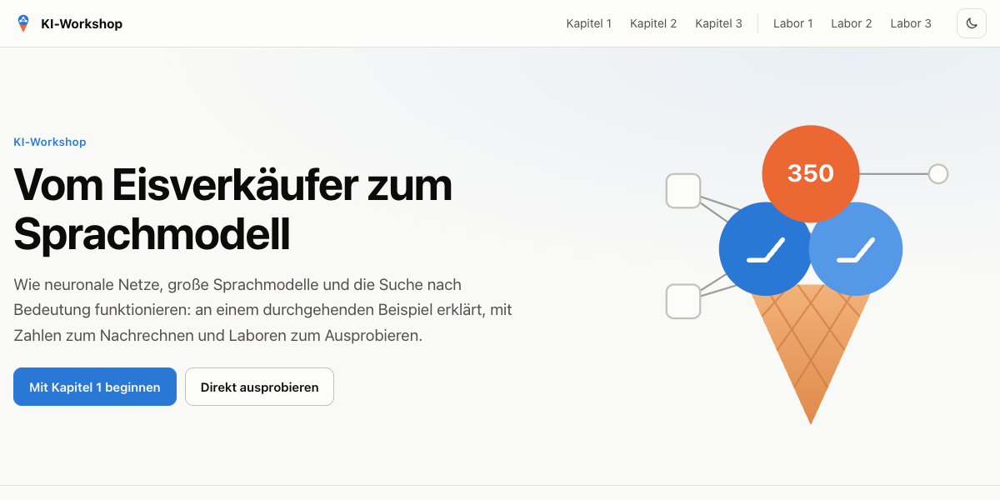
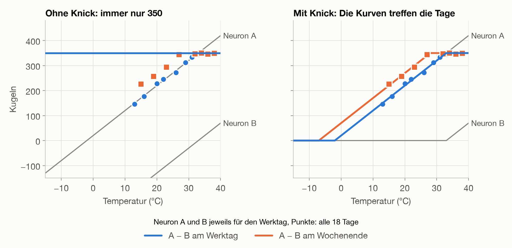
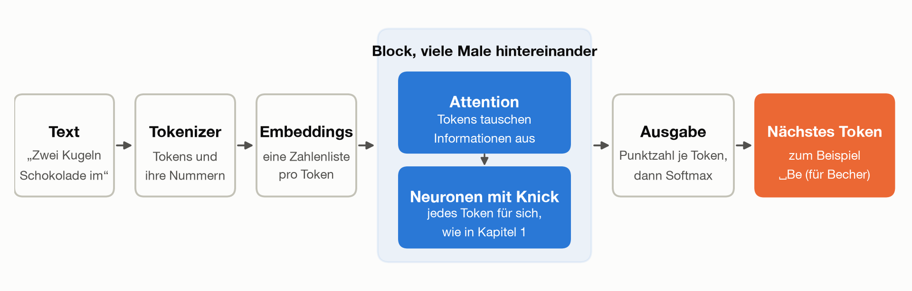
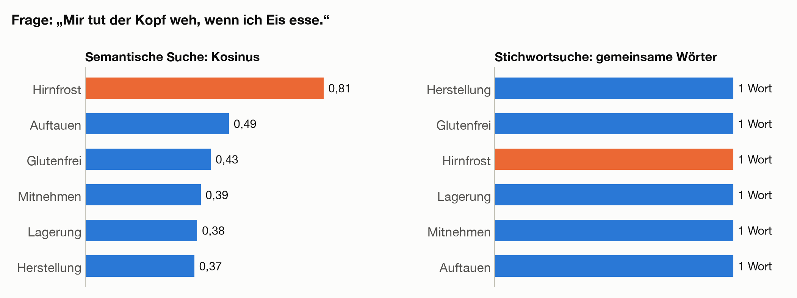
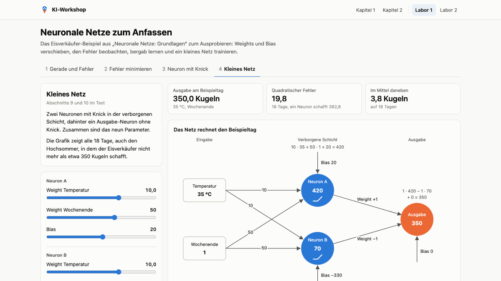
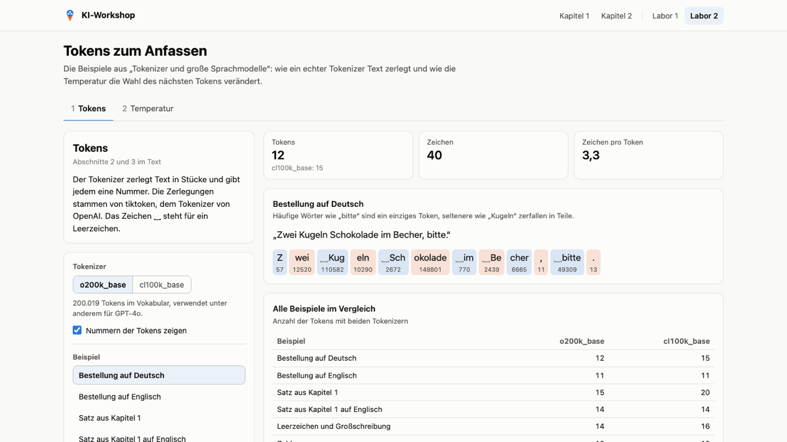
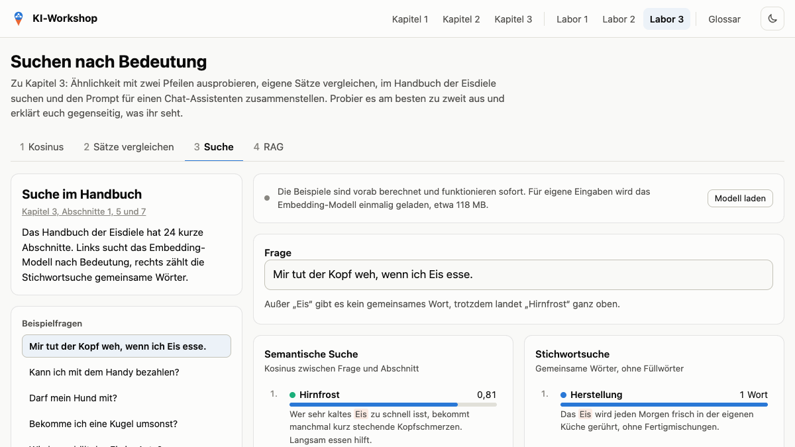

<div align="center">


# KI-Workshop: Vom Eisverkäufer zum Sprachmodell

**Wie neuronale Netze, große Sprachmodelle und die Suche nach Bedeutung funktionieren:<br>an einem durchgehenden Beispiel erklärt, mit Zahlen zum Nachrechnen und Laboren zum Ausprobieren.**

[**Zur Website**](https://kariha70.github.io/ki-workshop/) ·
[Kapitel 1](https://kariha70.github.io/ki-workshop/kapitel-1.html) ·
[Kapitel 2](https://kariha70.github.io/ki-workshop/kapitel-2.html) ·
[Kapitel 3](https://kariha70.github.io/ki-workshop/kapitel-3.html) ·
[Labore](https://kariha70.github.io/ki-workshop/#labore)

[](https://github.com/kariha70/ki-workshop/actions/workflows/pages.yml)

<a href="https://kariha70.github.io/ki-workshop/"></a>

</div>

## Worum es geht

Ein Eisverkäufer möchte wissen, wie viel Eis er morgen braucht. Aus dieser einfachen Frage entsteht Schritt für Schritt alles, was man zum Verständnis heutiger KI braucht: eine Gerade durch die Verkaufszahlen, ein Neuron, ein kleines Netz, ein Tokenizer, ein Sprachmodell und schließlich eine Suche, die nach Bedeutung statt nach Wörtern sucht.

Der Workshop richtet sich an alle, die verstehen wollen, was in einem Sprachmodell wie ChatGPT, Claude oder Llama passiert. Vorwissen ist nicht nötig, Schulmathematik reicht.

| | |
| --- | --- |
| 🍦 **Ein Beispiel, das trägt** | Statt vieler kleiner Beispiele gibt es eine Geschichte. Gerade, Neuron, Netz, Tokenizer und semantische Suche bauen alle auf den Daten des Eisverkäufers auf. |
| 🧮 **Jede Zahl nachrechenbar** | Zu jedem Kapitel gibt es ein Python-Skript, das alle Zahlen und Grafiken erzeugt. Nichts ist geschätzt oder von Hand eingetragen. |
| 🎛️ **Labore zum Anfassen** | Regler verschieben, bergab lernen, Tokens zerlegen, Pfeile drehen, im Handbuch der Eisdiele suchen. Alles läuft direkt im Browser. |

## Die Kapitel

<table>
<tr>
<td width="33%" valign="top">
<a href="https://kariha70.github.io/ki-workshop/kapitel-1.html"></a>
<h3>1 · Neuronale Netze: Grundlagen</h3>
Von der Geraden durch die Verkaufszahlen über Fehler, Gradientenabstieg und den Knick bis zum kleinen Netz, das selbst lernt.<br><br>
<sub>Lineare Regression · Weight und Bias · Quadratischer Fehler · Gradientenabstieg · Überanpassung · Aktivierungsfunktion · Backpropagation</sub><br><br>
⏱ etwa 25 Minuten Lesezeit
</td>
<td width="33%" valign="top">
<a href="https://kariha70.github.io/ki-workshop/kapitel-2.html"></a>
<h3>2 · Tokenizer und große Sprachmodelle</h3>
Wie Text zu Zahlen wird, was Embeddings und Attention leisten, warum größere Modelle besser werden und wo ihre Grenzen liegen.<br><br>
<sub>Nächstes Token · Kreuzentropie · Tokenizer · tiktoken · Embeddings · Attention · Transformer · Skalierung · Temperatur</sub><br><br>
⏱ etwa 15 Minuten Lesezeit
</td>
<td width="33%" valign="top">
<a href="https://kariha70.github.io/ki-workshop/kapitel-3.html"></a>
<h3>3 · Semantische Suche und RAG</h3>
Wie Embeddings ganze Texte vergleichbar machen, wie man damit nach Bedeutung sucht und wie RAG einem Sprachmodell neues Wissen mitgibt.<br><br>
<sub>Text-Embeddings · Kosinus · Embedding-Modell · Semantische Suche · Vektordatenbank · RAG · Hybride Suche</sub><br><br>
⏱ etwa 15 Minuten Lesezeit
</td>
</tr>
</table>

Die Kapitel bauen aufeinander auf. Die Texte liegen als Markdown in [`docs/`](docs) und werden für die Website in HTML umgewandelt.

## Die Labore

Zu jedem Kapitel gibt es eine interaktive Seite mit Aufgaben zum gemeinsamen Ausprobieren.

<table>
<tr>
<td width="33%" valign="top">
<a href="https://kariha70.github.io/ki-workshop/app/labor-1.html"></a>
<b>Labor 1: Neuronale Netze</b><br>
Gerade verschieben, Schritt für Schritt bergab lernen, den Knick einschalten und ein kleines Netz trainieren.
</td>
<td width="33%" valign="top">
<a href="https://kariha70.github.io/ki-workshop/app/labor-2.html"></a>
<b>Labor 2: Tokens und Temperatur</b><br>
Eigenen Text mit den echten Tokenizern von GPT-4o und GPT-4 zerlegen und die Temperatur beim Ziehen verstellen.
</td>
<td width="33%" valign="top">
<a href="https://kariha70.github.io/ki-workshop/app/labor-3.html"></a>
<b>Labor 3: Suchen nach Bedeutung</b><br>
Den Kosinus von Hand nachrechnen, Sätze vergleichen, im Handbuch der Eisdiele suchen und einen Prompt für RAG bauen.
</td>
</tr>
</table>

Labor 1 und 2 funktionieren auch ohne Internet. Labor 3 rechnet die Beispiele aus dem Text sofort. Für eigene Eingaben lädt es einmalig ein Embedding-Modell (etwa 118 MB) von Hugging Face und rechnet dann im Browser.

## Schnellstart

**Online lesen:** Alles liegt unter **[kariha70.github.io/ki-workshop](https://kariha70.github.io/ki-workshop/)**.

**Lokal starten:** Die Website braucht keinen Build-Schritt und keinen eigenen Server, ein einfacher statischer Server genügt:

```bash
git clone https://github.com/kariha70/ki-workshop.git
cd ki-workshop
python3 -m http.server --directory docs
# dann http://localhost:8000 öffnen
```

**Selbst nachrechnen:** Die Skripte brauchen nur [uv](https://docs.astral.sh/uv/). Die Abhängigkeiten installiert uv beim ersten Start selbst.

| Befehl | Was passiert |
| --- | --- |
| `uv run docs/beispiele/01_eisverkaeufer.py` | Rechnet Kapitel 1 nach und erzeugt alle Grafiken (etwa eine halbe Minute) |
| `uv run docs/beispiele/02_tokenizer.py "Drei Kugeln Vanille, bitte."` | Zerlegt eigenen Text mit `o200k_base` und `cl100k_base`. Ohne Text: alle Beispiele und Grafiken aus Kapitel 2 |
| `uv run docs/beispiele/03_semantische_suche.py "Habt ihr Eis für Hunde?"` | Durchsucht das Handbuch der Eisdiele. Ohne Frage: alle Zahlen, Grafiken und Labordaten aus Kapitel 3 |

> [!NOTE]
> Beim ersten Start laden manche Skripte Daten aus dem Internet: das zweite die Vokabulare von tiktoken, das dritte das Embedding-Modell in voller Genauigkeit (etwa 470 MB). Danach liegen sie im Cache.

## Den Workshop halten

Die Kapitel eignen sich zum Vortragen mit Beamer, die Labore zum Mitmachen am eigenen Laptop oder Handy. Ein möglicher Ablauf für einen Nachmittag:

| Block | Dauer | Inhalt |
| --- | --- | --- |
| Kapitel 1 | 60 min | Vom Eisverkäufer zum Netz, mit Labor 1 an den vier Stationen |
| Pause | 15 min | |
| Kapitel 2 | 45 min | Tokens, Transformer, Temperatur, mit Labor 2: den eigenen Namen zerlegen |
| Kapitel 3 | 45 min | Semantische Suche und RAG, mit Labor 3: Fragen ans Handbuch stellen |
| Abschluss | 15 min | Grenzen, Fragen, Ausblick |

**Vorbereitung:**

- [ ] Alle drei Skripte einmal starten, damit Vokabulare und Modell im Cache liegen.
- [ ] Labor 3 auf dem Vortragsrechner öffnen und „Modell laden“ drücken. Danach liegt das Modell im Browser-Cache und lädt beim nächsten Mal automatisch.
- [ ] Bei schwachem WLAN den Teilnehmenden raten, in Labor 3 bei den vorberechneten Beispielen zu bleiben.
- [ ] Hell oder dunkel: Oben rechts lässt sich das Design umschalten, auf dem Beamer ist hell meist besser lesbar.

Jedes Labor hat eine Karte „Ausprobieren“ mit Aufgaben, die sich gut für Kleingruppen eignen.

## Aufbau des Repos

```text
ki-workshop/
├── docs/                          Website, wird auf GitHub Pages veröffentlicht
│   ├── 01-Neuronale-Netze-Grundlagen.md
│   ├── 02-Tokenizer-und-Sprachmodelle.md
│   ├── 03-Semantische-Suche-und-RAG.md
│   ├── index.html, kapitel-*.html   erzeugt aus den Markdown-Dateien
│   ├── app/                       die Labore und ihre vorberechneten Daten
│   │   └── vendor/                js-tiktoken für Labor 2 und 3
│   ├── assets/                    Stylesheets, Skripte und Logo der Website
│   ├── beispiele/                 die Python-Skripte zu den Kapiteln
│   └── bilder/                    alle Grafiken, erzeugt von den Skripten
├── werkzeuge/
│   ├── seite_bauen.py             baut Startseite und Kapitelseiten
│   └── tiktoken/                  baut docs/app/vendor/tiktoken.js
└── .github/workflows/pages.yml    veröffentlicht docs/ bei jedem Push auf main
```

## Inhalte ändern

1. **Text bearbeiten:** Die Kapitel in `docs/*.md` ändern.
2. **Zahlen und Grafiken neu erzeugen:** Das passende Skript in `docs/beispiele/` ohne Argumente starten. Es schreibt die Grafiken nach `docs/bilder/` und die Labordaten nach `docs/app/`.
3. **Seiten bauen:** `uv run werkzeuge/seite_bauen.py` erzeugt `docs/index.html` und `docs/kapitel-*.html` neu. Die erzeugten Seiten werden mit eingecheckt.
4. **Veröffentlichen:** Ein Push auf `main` startet den Workflow, der `docs/` auf GitHub Pages stellt.

Ein paar Grundsätze, die sich durch alle Kapitel ziehen:

- Alle Daten im Beispiel sind erfunden, alle Zahlen im Text kommen aus den Skripten.
- Ausgedachte Werte, etwa in schematischen Grafiken, sind im Text als ausgedacht gekennzeichnet.
- Jedes Kapitel endet mit „Das Wichtigste in Kürze“, „Selbst ausprobieren“ und Quellen.
- Fachbegriffe werden beim ersten Auftreten erklärt und danach einheitlich verwendet, etwa *Weight* und *Bias*.

Das Bündel für js-tiktoken wird nur neu gebaut, wenn sich die Version ändern soll:

```bash
npm --prefix werkzeuge/tiktoken install
npm --prefix werkzeuge/tiktoken run bauen
```

## Verwendete Software

| Projekt | Wofür | Lizenz |
| --- | --- | --- |
| [js-tiktoken](https://github.com/dqbd/tiktoken) mit den Vokabularen aus [tiktoken](https://github.com/openai/tiktoken) | Tokenizer im Browser (Labor 2 und 3) | MIT, siehe [`LIZENZ.txt`](docs/app/vendor/LIZENZ.txt) |
| [Transformers.js](https://huggingface.co/docs/transformers.js) | Embedding-Modell im Browser (Labor 3), wird von jsDelivr geladen | Apache-2.0 |
| [paraphrase-multilingual-MiniLM-L12-v2](https://huggingface.co/sentence-transformers/paraphrase-multilingual-MiniLM-L12-v2) | Embedding-Modell für Kapitel 3 | Apache-2.0 |
| [NumPy](https://numpy.org), [Matplotlib](https://matplotlib.org), [ONNX Runtime](https://onnxruntime.ai), [Python-Markdown](https://python-markdown.github.io) | Skripte und Seitenbau | jeweils eigene freie Lizenz |

Die Quellen zu den Inhalten, von „Attention Is All You Need“ bis zu RAG, stehen am Ende jedes Kapitels.

## Lizenz

Die Unterlagen dürfen gern für eigene Workshops, im Unterricht oder in der Community verwendet und angepasst werden.

| Was | Lizenz |
| --- | --- |
| **Inhalte:** die Kapiteltexte in `docs/*.md`, die daraus erzeugten Seiten und alle Grafiken in `docs/bilder/` | [CC BY 4.0](https://creativecommons.org/licenses/by/4.0/deed.de), siehe [`LICENSE-INHALTE`](LICENSE-INHALTE) |
| **Code:** die Skripte, die Labore, Stylesheets und Werkzeuge | [MIT](LICENSE) |
| **Fremde Software** in `docs/app/vendor/` | eigene Lizenz, siehe [`LIZENZ.txt`](docs/app/vendor/LIZENZ.txt) |

Bei Weitergabe der Inhalte bitte als Quelle angeben: *KI-Workshop: Vom Eisverkäufer zum Sprachmodell* von Kari Hagemeier, mit Link auf dieses Repository.
