# Neuronale Netze: Grundlagen

Ein neuronales Netz klingt kompliziert, ist im Kern aber aus einem sehr einfachen Baustein zusammengesetzt: dem Neuron. Und ein Neuron rechnet im Grunde nichts anderes als eine lineare Regression, wie sie viele aus dem Matheunterricht als Gerade kennen, mit einem kleinen Knick am Ende.

Dieses Beispiel führt in zehn Schritten von der Geraden über das Neuron bis zum kleinen neuronalen Netz.

## 1. Der Eisverkäufer

Ein Eisverkäufer notiert an zehn Tagen die Temperatur und die Zahl der verkauften Kugeln (die Zahlen sind für dieses Beispiel erfunden):

| Temperatur (°C) | Verkaufte Kugeln |
| --------------- | ---------------- |
| 13              | 146              |
| 15              | 226              |
| 16              | 177              |
| 19              | 257              |
| 20              | 228              |
| 22              | 245              |
| 23              | 293              |
| 26              | 272              |
| 27              | 344              |
| 29              | 312              |

Der Eisverkäufer möchte wissen: **Wie viele Kugeln verkaufe ich morgen, wenn es 25 °C warm wird?** Dann kann er genau so viel Eis vorbereiten, wie er braucht.

Die Tabelle zeigt schon einen Trend: Je wärmer es ist, desto mehr Eis wird verkauft.

## 2. Lineare Regression: Eine Gerade durch die Punkte

Die lineare Regression legt eine Gerade so durch die Messpunkte, dass sie insgesamt möglichst wenig danebenliegt. Für unsere Daten ist das diese Gerade:

```text
Kugeln = 10 · Temperatur + 40
```

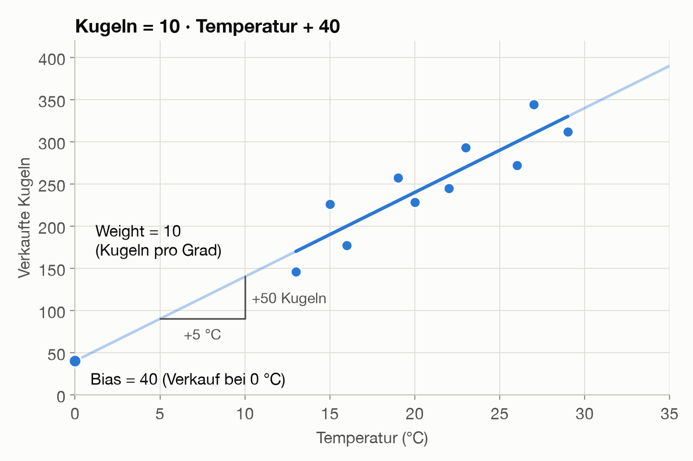

Damit lässt sich die Frage beantworten:

```text
Kugeln = 10 · 25 + 40 = 290
```

Die Gerade trifft die Messpunkte nicht genau. Im Mittel liegt sie um **24 Kugeln** daneben. Das ist die Zahl, die wir später verbessern wollen.

## 3. Weight und Bias

Die Gerade hat genau zwei Stellschrauben. Sie heißen in der Welt der neuronalen Netze **Weight** und **Bias**:

| Begriff           | In der Geraden       | Wert | Bedeutung im Beispiel                               |
| ----------------- | -------------------- | ---- | --------------------------------------------------- |
| Weight (Gewicht)  | Steigung             | 10   | Jedes Grad mehr bringt 10 Kugeln mehr.              |
| Bias              | Schnitt mit der y-Achse | 40   | Das ist der Verkauf, wenn die Temperatur 0 °C beträgt. |

- Das **Weight** sagt, wie stark ein Input die Vorhersage beeinflusst. Ein großes Weight bedeutet: Die Temperatur ist sehr wichtig. Ein Weight von 0 würde bedeuten: Die Temperatur spielt keine Rolle.
- Der **Bias** ist der Grundwert, zu dem alles andere dazukommt. Er hat nichts mit „Vorurteilen“ zu tun, von denen im Zusammenhang mit KI oft die Rede ist.

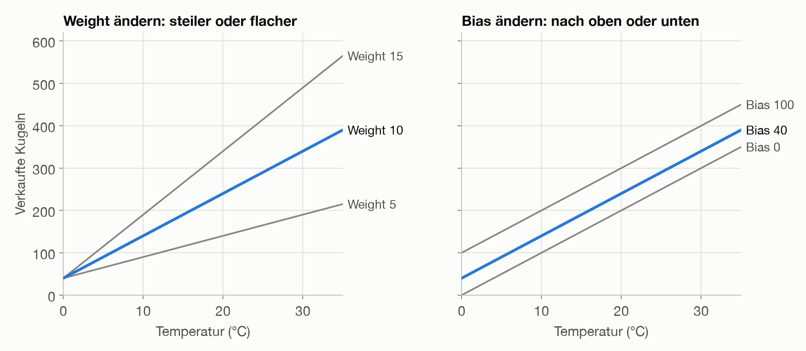

Gemessen wurde nur zwischen 13 und 29 °C, außerhalb dieses Bereichs ist die Gerade deshalb reine Fortschreibung (in der ersten Grafik heller gezeichnet). Bei −10 °C würde sie sogar −60 Kugeln vorhersagen. Ein Modell kennt nur das, was in seinen Daten steckt. (Auf dieses Problem kommen wir in Abschnitt 9 zurück.)

Mehr als diese beiden Zahlen merkt sich das Modell nicht, die Messwerte selbst speichert es gar nicht. Weights und Bias zusammen heißen die **Parameter** des Modells. **Lernen heißt hier: die beiden Werte finden, die am besten zu den Daten passen.** Aber was heißt „am besten“?

## 4. Fehler messen: Warum Quadrate?

Um die Linie gezielt zu verändern, brauchen wir eine einzige Zahl, die sagt: Ist die Linie jetzt besser oder schlechter als vorher? Diese Zahl entsteht in drei Schritten.

**Schritt 1: Für jeden Tag den Fehler berechnen.** Der Fehler ist der Abstand zwischen Messwert und Vorhersage:

```text
Fehler = verkaufte Kugeln − Vorhersage
```

| Temperatur (°C) | Verkaufte Kugeln | Vorhersage | Fehler | Fehler zum Quadrat |
| --------------- | ---------------- | ---------- | ------ | ------------------ |
| 13              | 146              | 170        | −24    | 576                |
| 15              | 226              | 190        | +36    | 1296               |
| 16              | 177              | 200        | −23    | 529                |
| 19              | 257              | 230        | +27    | 729                |
| 20              | 228              | 240        | −12    | 144                |
| 22              | 245              | 260        | −15    | 225                |
| 23              | 293              | 270        | +23    | 529                |
| 26              | 272              | 300        | −28    | 784                |
| 27              | 344              | 310        | +34    | 1156               |
| 29              | 312              | 330        | −18    | 324                |
| **Summe**       |                  |            | **0**  | **6292**           |

**Schritt 2: Die Fehler quadrieren.** Die Summe der einfachen Fehler ist genau 0, obwohl die Linie an keinem Tag richtig liegt. Plus und Minus heben sich gegenseitig auf, die Summe sagt also nichts aus. Noch deutlicher zeigt das eine waagerechte Linie bei 250 Kugeln: Sie ignoriert die Temperatur völlig, ihre Fehlersumme ist aber ebenfalls 0. Erst die Quadrate zeigen den Unterschied. In der Grafik ist jedes orange Quadrat buchstäblich das Quadrat eines Fehlers, und rechts bedecken sie eine viel größere Fläche:

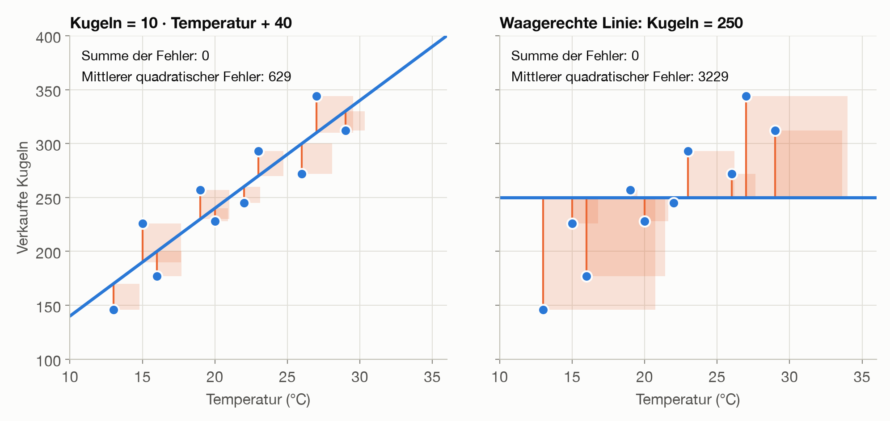

**Schritt 3: Den Durchschnitt bilden.** Das Ergebnis heißt **mittlerer quadratischer Fehler** (englisch Mean Squared Error, kurz MSE):

```text
Mittlerer quadratischer Fehler = 6292 / 10 = 629,2
```

Allgemein heißt eine solche Fehlerzahl **Verlustfunktion** (englisch Loss). Wenn in KI-Artikeln vom „Loss“ die Rede ist, ist genau das gemeint.

Das Quadrieren hat drei Vorteile:

1. **Das Vorzeichen verschwindet.** Zu viel und zu wenig Vorhersage zählen beide als Fehler und können sich nicht mehr aufheben.
2. **Große Fehler zählen besonders stark.** Ein Fehler von 20 kostet 400 Punkte, zwei Fehler von je 10 nur zusammen 200. Die Linie vermeidet also lieber einen groben Fehlgriff als mehrere kleine. Die Kehrseite: Ein einzelner Ausreißer kann die Linie spürbar zu sich ziehen.
3. **Die Fehlerkurve ist glatt.** Sie zeigt an jeder Stelle, in welche Richtung es bergab geht. Das ist der wichtigste Grund, und er erklärt auch, warum man nicht einfach die Vorzeichen weglässt: Das funktioniert zwar auch, die Kurve hat dann aber Knicke, und die Rechnung wird schwieriger.

Die Einheit des Ergebnisses ist allerdings „Kugeln zum Quadrat“, und darunter kann sich niemand etwas vorstellen. Für Menschen nennen wir deshalb weiter die mittlere Abweichung ohne Vorzeichen, hier 24 Kugeln. Zum Lernen nimmt das Modell den quadratischen Fehler.

### Die Linie verändern

Mit dieser Zahl können wir Linien vergleichen. Ändern wir Weight oder Bias, wird der Fehler größer:

| Weight | Bias | Mittlerer quadratischer Fehler |
| ------ | ---- | ------------------------------ |
| 8      | 40   | 2497,2                         |
| **10** | **40** | **629,2**                    |
| 12     | 40   | 2497,2                         |
| 10     | 20   | 1029,2                         |
| 10     | 60   | 1029,2                         |

Trägt man den Fehler für alle möglichen Weights auf, entsteht eine Kurve wie ein Tal:

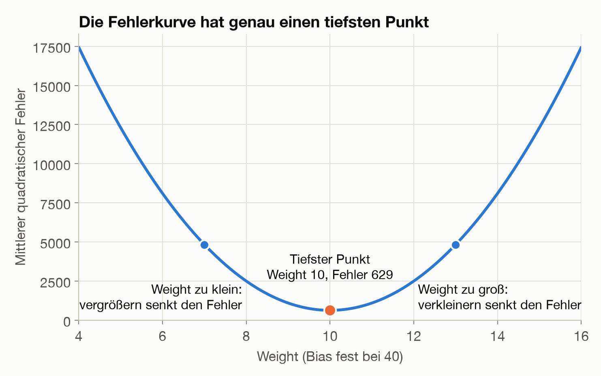

Das Modell sucht den tiefsten Punkt dieses Tals. Links davon muss das Weight größer werden, rechts davon kleiner. Für Weight und Bias zusammen wird aus der Kurve eine Schüssel, und ihr tiefster Punkt ergibt die beste Linie. **Lernen heißt also: den Fehler so klein wie möglich machen.**

## 5. Den Fehler minimieren: Schritt für Schritt bergab

Bisher haben wir die beste Linie einfach angegeben. Wie findet man sie, wenn man sie nicht kennt?

Stellen wir uns vor, wir stehen im dichten Nebel in einem Tal und wollen zum tiefsten Punkt. Wir sehen das Ziel nicht, spüren aber unter den Füßen, wohin der Boden abfällt. Also gehen wir ein Stück in diese Richtung und prüfen dann erneut. Genau so arbeitet der **Gradientenabstieg** (englisch Gradient Descent):

1. Mit einem beliebigen Wert starten.
2. Die Steigung der Fehlerkurve an dieser Stelle messen.
3. Ein kleines Stück bergab gehen.
4. Die Schritte 2 und 3 wiederholen, bis der Fehler nicht mehr sinkt.

### Die Steigung messen

Zum Ausprobieren lernen wir zuerst nur das Weight und lassen den Bias bei 40. Wir starten mit Weight 0, also mit einem Fehler von 47329,2. Erhöhen wir das Weight probeweise auf 0,01, sinkt der Fehler auf 47235,8. Das sind 93,4 weniger auf nur 0,01 Weight, also eine Steigung von rund −9340. Das Minus sagt uns: Nach rechts geht es bergab, das Weight muss größer werden.

Das Ausprobieren können wir uns sparen. Die Mathematik (die Ableitung des quadratischen Fehlers) liefert die Steigung direkt:

```text
Steigung für das Weight = −2 · Durchschnitt(Fehler · Input)
Steigung für den Bias   = −2 · Durchschnitt(Fehler)
```

Alle Steigungen zusammen heißen **Gradient**, daher der Name des Verfahrens.

Auch das lässt sich anschaulich lesen: Liegen die Vorhersagen zu niedrig, sind die Fehler positiv, die Steigung wird negativ, und das Weight wächst. Tage mit großem Input haben dabei mehr Einfluss, weil sich das Weight dort stärker auswirkt.

### Der Schritt bergab

```text
neues Weight = altes Weight − Lernrate · Steigung
```

Das Minus sorgt dafür, dass wir gegen die Steigung gehen, also bergab. Die **Lernrate** legt fest, wie groß der Schritt wird. Mit einer Lernrate von 0,0005 lautet der erste Schritt:

```text
neues Weight = 0 − 0,0005 · (−9340) = 4,67
```

Wiederholen wir das, nähert sich das Weight dem besten Wert 10:

| Schritt | Weight | Steigung | Änderung | Mittlerer quadratischer Fehler |
| ------- | ------ | -------- | -------- | ------------------------------ |
| 0       | 0,00   | −9340,0  | +4,67    | 47329,2                        |
| 1       | 4,67   | −4978,2  | +2,49    | 13896,2                        |
| 2       | 7,16   | −2653,4  | +1,33    | 4398,2                         |
| 3       | 8,49   | −1414,3  | +0,71    | 1699,9                         |
| 4       | 9,19   | −753,8   | +0,38    | 933,4                          |
| 5       | 9,57   | −401,8   | +0,20    | 715,6                          |
| 6       | 9,77   | −214,1   | +0,11    | 653,7                          |
| 7       | 9,88   | −114,1   | +0,06    | 636,2                          |
| 8       | 9,93   | −60,8    | +0,03    | 631,2                          |

Die Schritte werden von selbst kleiner, denn je näher wir dem Talboden kommen, desto flacher wird die Kurve. Ganz auf 0 fällt der Fehler nicht: Unter 629,2 kommt diese Linie nicht, weil die Punkte nicht exakt auf einer Geraden liegen.

### Die richtige Lernrate

Die Lernrate muss man selbst wählen, und sie entscheidet darüber, ob das Lernen funktioniert. Die Grafik zeigt jeweils sechs Schritte vom selben Startpunkt aus (blau):

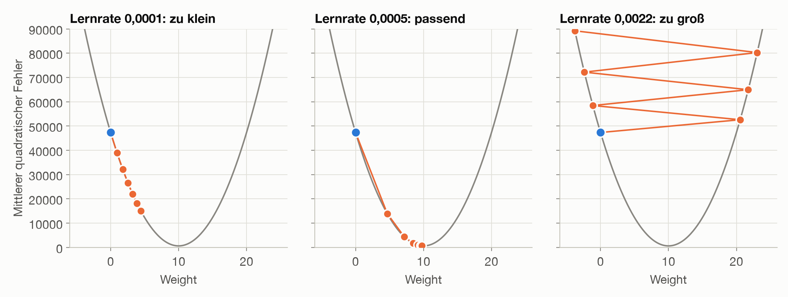

- **Zu klein:** Das Verfahren funktioniert, braucht aber sehr viele Schritte.
- **Passend:** Nach wenigen Schritten ist der Talboden fast erreicht.
- **Zu groß:** Jeder Schritt springt über das Tal hinweg und landet höher als der vorige. Der Fehler wächst, statt zu sinken.

### Weight und Bias zusammen lernen

*Dieser Teil vertieft das Verfahren und kann im Workshop bei knapper Zeit übersprungen werden.*

In Wirklichkeit lernt das Modell alle Werte gleichzeitig. Jeder bekommt in jedem Schritt seine eigene Steigung:

```python
for schritt in range(100_000):
    fehler = kugeln - (weight * temperatur + bias)
    weight += lernrate * 2 * np.mean(fehler * temperatur)
    bias += lernrate * 2 * np.mean(fehler)
```

Mit Start bei Weight 0 und Bias 0 und einer Lernrate von 0,001 ergibt sich:

| Schritte | Weight | Bias  | Mittlerer quadratischer Fehler |
| -------- | ------ | ----- | ------------------------------ |
| 0        | 0,00   | 0,00  | 65729,2                        |
| 1        | 11,02  | 0,50  | 983,1                          |
| 10       | 11,77  | 0,57  | 715,7                          |
| 100      | 11,76  | 0,97  | 714,0                          |
| 1000     | 11,59  | 4,68  | 698,7                          |
| 10000    | 10,58  | 27,01 | 638,6                          |
| 50000    | 10,01  | 39,85 | 629,2                          |
| 100000   | 10,00  | 40,00 | 629,2                          |

Das Modell findet die Linie aus Abschnitt 2 also von selbst. Auffällig ist: Das Weight schießt zunächst über 10 hinaus, weil es den fehlenden Bias ausgleicht. Danach wächst der Bias nur langsam, denn in der Steigung zählt jeder Fehler beim Weight mit dem Faktor Temperatur (bis 29), beim Bias aber nur einfach. Das Weight bestimmt deshalb die Richtung. In der Praxis rechnet man die Inputs deshalb vorher auf eine ähnliche Größenordnung um (Skalieren). In unserem Beispiel reichen dann 36 statt rund 40800 Schritte.

Für eine einzelne Gerade gibt es sogar eine fertige Formel, die das Ergebnis direkt ausrechnet. Der Gradientenabstieg ist hier also ein Umweg. Er ist aber der Weg, der auch bei neuronalen Netzen mit Millionen von Weights funktioniert, wo es keine solche Formel gibt.

## 6. Eine zweite Beobachtung: das Wochenende

Warum liegt die Gerade an manchen Tagen so weit daneben? Der Eisverkäufer schaut in seine Notizen: Die Ausreißer nach oben waren Wochenenden. Also notiert er eine zweite Beobachtung.

Der Computer rechnet nur mit Zahlen, deshalb wird daraus: **1 = Wochenende, 0 = Werktag**. Die Nummer des Wochentags (Montag = 1 bis Sonntag = 7) wäre keine gute Wahl, denn sie würde behaupten, dass der Sonntag „siebenmal so viel“ zählt wie der Montag.

| Temperatur (°C) | Wochenende | Verkaufte Kugeln |
| --------------- | ---------- | ---------------- |
| 13              | 0          | 146              |
| 15              | 1          | 226              |
| 16              | 0          | 177              |
| 19              | 1          | 257              |
| 20              | 0          | 228              |
| 22              | 0          | 245              |
| 23              | 1          | 293              |
| 26              | 0          | 272              |
| 27              | 1          | 344              |
| 29              | 0          | 312              |

Die Formel bekommt dafür ein zweites Weight:

```text
Kugeln = 10 · Temperatur + 50 · Wochenende + 20
```

Für einen Tag mit 25 °C heißt das:

```text
Werktag:  10 · 25 + 50 · 0 + 20 = 270
Samstag:  10 · 25 + 50 · 1 + 20 = 320
```

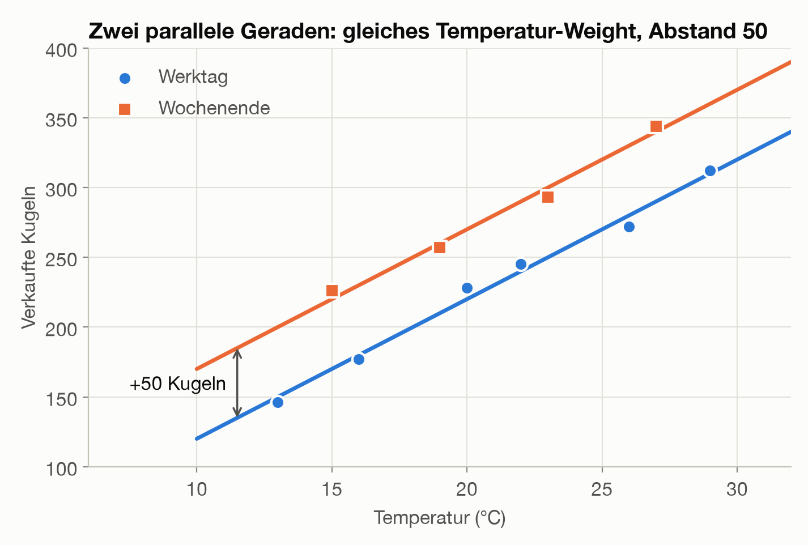

Die eine Gerade hat sich in zwei parallele Geraden aufgeteilt, und die Vorhersage wird deutlich besser:

| Modell                  | Formel                                   | Im Mittel daneben | Mittlerer quadratischer Fehler |
| ----------------------- | ---------------------------------------- | ----------------- | ------------------------------ |
| Nur Temperatur          | `10 · Temperatur + 40`                   | 24 Kugeln         | 629,2                          |
| Temperatur + Wochenende | `10 · Temperatur + 50 · Wochenende + 20` | 5 Kugeln          | 29,2                           |

Der Bias ist dabei von 40 auf 20 gesunken. Vier der zehn Tage waren Wochenenden, also steckten im alten Bias durchschnittlich 0,4 · 50 = 20 Kugeln Wochenend-Effekt. Jetzt hat dieser Effekt ein eigenes Weight. Das Temperatur-Weight bleibt nur deshalb bei 10, weil die Wochenenden in unseren Daten im Schnitt genauso warm waren wie die Werktage. Bei echten Daten verschieben sich meist alle Werte.

Damit kann der Eisverkäufer seine Frage aus Abschnitt 1 endlich richtig beantworten: Bei 25 °C sollte er an einem Werktag 270 Kugeln einplanen, an einem Samstag 320. Die 290 aus Abschnitt 2 waren nur ein Mittelwert, denn 6 von 10 Tagen waren Werktage und 4 Wochenendtage: 0,6 · 270 + 0,4 · 320 = 290.

Hier zeigen sich auch die zwei Phasen, die jedes Modell durchläuft: Beim **Training** ändern sich die Weights, und aus den Daten entstehen die Parameter. Bei der **Anwendung** (auch Inferenz genannt) bleiben die Weights fest, und das Modell rechnet nur noch Vorhersagen aus.

## 7. Funktioniert es auch an neuen Tagen?

Bisher haben wir den Fehler nur an den Tagen gemessen, mit denen das Modell gelernt hat. Der Eisverkäufer will aber wissen, was *morgen* passiert. Das ist wie eine Prüfung, in der nur Aufgaben vorkommen, deren Lösungen man schon gesehen hat.

Deshalb prüfen wir das Modell an Tagen, die es beim Lernen nicht kannte: Wir lassen jeden der zehn Tage einmal weg, lernen mit den übrigen neun und sagen den ausgelassenen Tag vorher. Zum Vergleich geben wir dem Modell außerdem Zufallszahlen als zusätzliche, völlig sinnlose Inputs:

| Modell                                 | Fehler auf den Trainingstagen | Fehler auf neuen Tagen |
| -------------------------------------- | ----------------------------- | ---------------------- |
| Nur Temperatur                         | 629                           | 1043                   |
| Temperatur + Wochenende                | 29                            | 57                     |
| Temperatur + Wochenende + 1 Zufallszahl | 27                           | 72                     |
| Temperatur + Wochenende + 3 Zufallszahlen | 16                         | 127                    |
| Temperatur + Wochenende + 6 Zufallszahlen | 2                          | 2980                   |

Angegeben ist jeweils der mittlere quadratische Fehler, bei den Zufallszahlen der Median aus 200 Durchläufen.

Die Tabelle zeigt dreierlei:

- Auf neuen Tagen ist der Fehler immer größer als auf den Trainingstagen. Nur diese zweite Zahl sagt etwas über morgen.
- Das Wochenende hilft wirklich, auch auf neuen Tagen sinkt der Fehler deutlich.
- Sinnlose Inputs senken den Trainingsfehler ebenfalls, auf neuen Tagen wird das Modell aber immer schlechter. Mit 6 Zufallszahlen sieht es im Training fast perfekt aus und versagt, sobald es ernst wird.

Das nennt man **Überanpassung** (englisch Overfitting): Das Modell lernt die zufälligen Schwankungen der Trainingstage auswendig, statt den Zusammenhang zu erkennen. Im Extremfall hat es 10 Parameter für 10 Tage und damit einen Trainingsfehler von genau 0.

Die Regel daraus: **Ein Modell wird immer an Daten geprüft, die es beim Training nicht gesehen hat.** Üblicherweise legt man dafür vor dem Training einen Teil der Daten als Testdaten beiseite. Und mehr Inputs oder Parameter sind nicht automatisch besser.

## 8. Vom Modell zum Neuron

Jetzt zeichnen wir dieselbe Formel anders auf, und schon haben wir die Grundform eines Neurons:

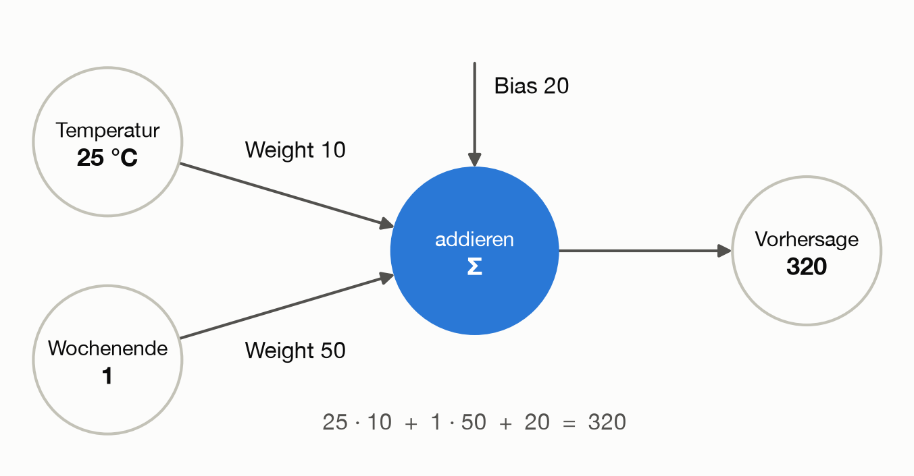

Der Name stammt von den Nervenzellen im Gehirn: Sie empfangen Signale von anderen Zellen, verstärken manche davon und feuern selbst, wenn genug zusammenkommt. Das ist allerdings nur ein grobes Vorbild, ein künstliches Neuron ist eine einfache Rechenformel.

Unser Neuron macht bisher drei Dinge:

1. Es nimmt **Inputs** entgegen (Temperatur und Wochenende).
2. Es multipliziert jeden Input mit seinem **Weight**.
3. Es addiert alles und zählt den **Bias** dazu. Das Ergebnis ist die **Vorhersage**.

Als Code ist das nur eine Zeile:

```python
def neuron(inputs, weights, bias):
    return sum(x * w for x, w in zip(inputs, weights)) + bias


neuron([25, 1], [10, 50], 20)  # 320
```

| Lineare Regression        | Neuron     |
| ------------------------- | ---------- |
| Beobachtungen             | Inputs     |
| Steigungen                | Weights    |
| Schnitt mit der y-Achse   | Bias       |
| Ergebnis der Formel       | Vorhersage |

Auch das Training ist dasselbe: Mit den Schritten aus Abschnitt 5 lernt das Neuron von Weights und Bias 0 aus die Werte 10, 50 und 20 (nach 100000 Schritten mit einer Lernrate von 0,001).

**Zum Mitrechnen:** Was sagt das Neuron für einen Sonntag mit 18 °C voraus? Lösung: 18 · 10 + 1 · 50 + 20 = 250 Kugeln.

Bis hierher kann unser Neuron nur Geraden (bei zwei Inputs genau genommen eine Ebene). Für ein vollständiges Neuron fehlt noch ein letzter Baustein.

## 9. Der Knick: die Aktivierungsfunktion

Erinnern wir uns an das Problem aus Abschnitt 3: Bei −10 °C an einem Werktag rechnet unser Neuron 10 · (−10) + 50 · 0 + 20 = −80 Kugeln aus. Das ist Unsinn, denn weniger als 0 Kugeln kann niemand verkaufen.

Die Lösung ist eine kleine Regel, die das Neuron am Ende auf sein Ergebnis anwendet: **Ist das Ergebnis negativ, gib 0 aus, sonst das Ergebnis selbst.** Diese Regel heißt **Aktivierungsfunktion**, und die hier gezeigte ist die gebräuchlichste. Sie heißt ReLU (Rectified Linear Unit). Dadurch bekommt jede der beiden Geraden aus Abschnitt 6 einen Knick, am Werktag bei −2 °C und am Wochenende bei −7 °C:

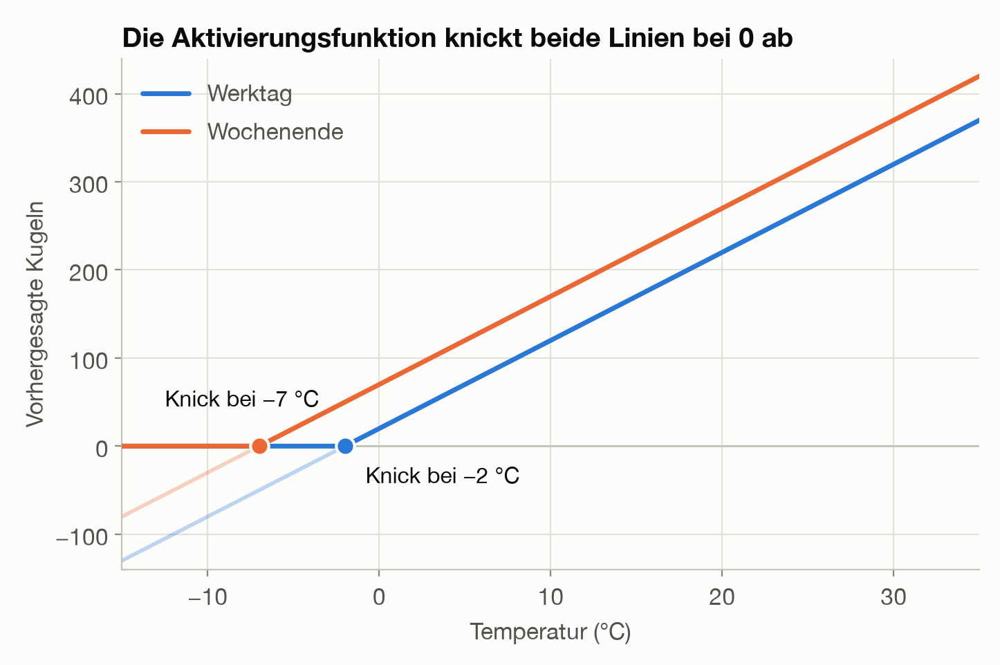

Der Name passt: Liegt die Summe unter 0, bleibt das Neuron stumm, darüber ist es aktiv. Im Neuron kommt damit ein vierter Schritt hinzu:

1. Es nimmt **Inputs** entgegen.
2. Es multipliziert jeden Input mit seinem **Weight**.
3. Es addiert alles und zählt den **Bias** dazu.
4. Es gibt die Summe durch die **Aktivierungsfunktion**. Das Ergebnis ist die **Vorhersage**.

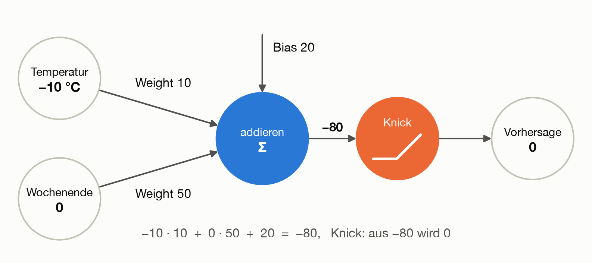

```python
def aktivierung(wert):
    return max(0, wert)


def neuron_mit_knick(inputs, weights, bias):
    return aktivierung(neuron(inputs, weights, bias))


neuron_mit_knick([-10, 0], [10, 50], 20)  # 0, statt −80
neuron_mit_knick([25, 1], [10, 50], 20)  # 320, wie bisher
```

Für unsere zehn Beobachtungstage ändert sich an den besten Werten nichts, weil dort alle Vorhersagen positiv sind. Weights, Bias und Fehler bleiben also gleich.

Für das Training hat der Knick aber eine Folge: Im abgeschnittenen Bereich bleibt die Ausgabe 0, egal wie wir die Weights ein wenig verändern. Die Steigung ist dort also 0, und das Neuron lernt an solchen Tagen nichts. Sind alle Tage betroffen, bleibt es für immer stehen:

| Start (Weights, Bias) | Ergebnis nach 100000 Schritten | Mittlerer quadratischer Fehler |
| --------------------- | ------------------------------ | ------------------------------ |
| 0, 0, 0               | bleibt bei 0, 0, 0             | 65729,2                        |
| −1, 0, 0              | bleibt bei −1, 0, 0            | 65729,2                        |
| 1, 1, 1               | findet 10, 50, 20              | 29,2                           |

Das nennt man ein **totes Neuron**. Der Startwert 0 aus Abschnitt 5 wäre hier also keine gute Wahl. In Abschnitt 10 sehen wir, wie man damit umgeht.

Dieser Knick ist übrigens ein anderer als die Knicke der Fehlerkurve aus Abschnitt 4: Er sitzt in der Vorhersage, nicht im Fehlermaß. Solange nicht alle Tage abgeschnitten werden, kommt das Training gut damit zurecht.

### Warum der Knick unverzichtbar ist

Negative Kugeln zu vermeiden ist nur der kleinere Nutzen. Wirklich wichtig wird der Knick, sobald mehrere Neuronen zusammenarbeiten.

Der Sommer geht weiter, und der Eisverkäufer notiert acht weitere Tage. Daneben steht, was unser Neuron aus Abschnitt 8 dafür vorhergesagt hätte:

| Temperatur (°C) | Wochenende | Verkaufte Kugeln | Vorhersage | Fehler |
| --------------- | ---------- | ---------------- | ---------- | ------ |
| 31              | 0          | 333              | 330        | +3     |
| 32              | 1          | 347              | 390        | −43    |
| 33              | 0          | 345              | 350        | −5     |
| 34              | 1          | 350              | 410        | −60    |
| 35              | 0          | 348              | 370        | −22    |
| 36              | 1          | 346              | 430        | −84    |
| 37              | 0          | 350              | 390        | −40    |
| 38              | 1          | 349              | 450        | −101   |

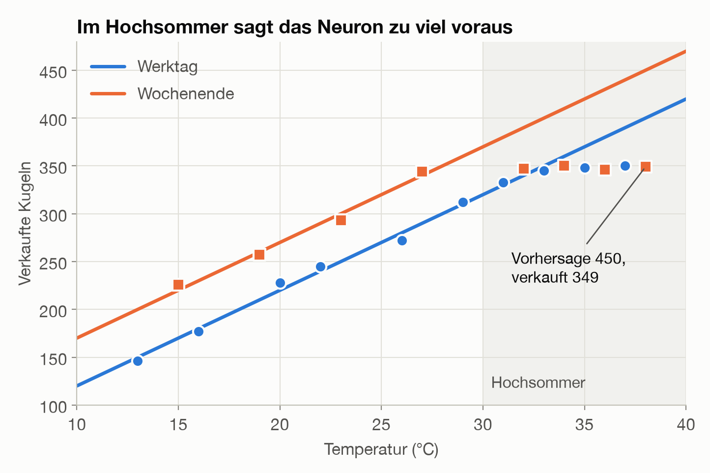

Bei rund 350 Kugeln ist Schluss, mehr schafft der Eisverkäufer an einem Tag nicht. Unser Neuron merkt davon nichts: Es sagt weiter steigende Verkäufe voraus und liegt auf den neuen Tagen im Mittel um 45 Kugeln daneben, am heißesten Tag (38 °C, Wochenende) sogar um 101.

Vielleicht fehlt nur neues Training? Lernt das Neuron noch einmal mit allen 18 Tagen, ergibt sich etwa `7,4 · Temperatur + 25,1 · Wochenende + 81,9`. Die Hochsommertage passen dann besser, dafür passen die anderen schlechter. Das Problem bleibt, denn eine Gerade kann nicht erst steigen und dann stehen bleiben.

Versuchen wir es mit zwei Neuronen, deren Ausgaben wir voneinander abziehen. Beide bekommen Temperatur und Wochenende als Inputs, die Werte setzen wir vorerst von Hand:

```text
Neuron A = 10 · Temperatur + 50 · Wochenende + 20
Neuron B = 10 · Temperatur + 50 · Wochenende − 330
Ergebnis = A − B
```

Ohne Knick passiert etwas Ernüchterndes: Temperatur und Wochenende fallen beim Abziehen heraus, und es bleibt immer dieselbe Zahl übrig. Zwei Geraden ergeben zusammen wieder nur eine Gerade, egal wie viele Neuronen wir verwenden. Mit Knick entsteht dagegen genau die gesuchte Form:

| Tag      | Temperatur (°C) | Ohne Knick: A | Ohne Knick: B | Ohne Knick: A − B | Mit Knick: A | Mit Knick: B | Mit Knick: A − B |
| -------- | --------------- | ------------- | ------------- | ----------------- | ------------ | ------------ | ---------------- |
| Werktag  | −10             | −80           | −430          | 350               | 0            | 0            | **0**            |
| Werktag  | 20              | 220           | −130          | 350               | 220          | 0            | **220**          |
| Werktag  | 33              | 350           | 0             | 350               | 350          | 0            | **350**          |
| Werktag  | 35              | 370           | 20            | 350               | 370          | 20           | **350**          |
| Samstag  | 28              | 350           | 0             | 350               | 350          | 0            | **350**          |
| Samstag  | 35              | 420           | 70            | 350               | 420          | 70           | **350**          |

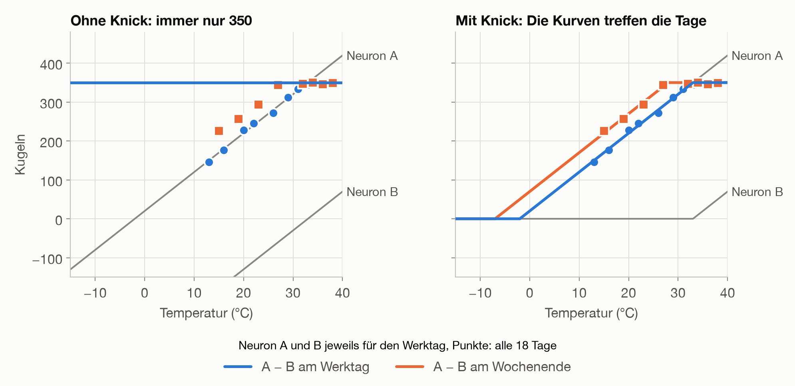

Die Kurven treffen jetzt die beobachteten Tage, und das Wochenende verschiebt sie dabei nach links: Am Wochenende ist das Limit schon bei 28 °C erreicht, am Werktag erst bei 33 °C. Auf allen 18 Tagen zeigt sich der Unterschied deutlich:

| Modell                          | Im Mittel daneben | Davon Hochsommertage | Mittlerer quadratischer Fehler |
| ------------------------------- | ----------------- | -------------------- | ------------------------------ |
| Neuron aus Abschnitt 8          | 22,7 Kugeln       | 44,8 Kugeln          | 1395,3                         |
| Neuron, mit 18 Tagen neu gelernt | 15,4 Kugeln      | 16,5 Kugeln          | 382,8                          |
| Zwei Neuronen mit Knick, von Hand gesetzt | 3,8 Kugeln | 2,2 Kugeln         | 19,8                           |

Jedes Neuron bringt seinen eigenen Knick an einer anderen Stelle mit. Mit genügend Knicken lässt sich fast jede Kurve annähern, so wie man einen Kreis aus vielen kurzen Geraden zeichnen kann. **Erst der Knick macht aus vielen Neuronen mehr als eine einzige Gerade.**

Neben ReLU gibt es weitere Aktivierungsfunktionen, etwa die S-förmige Sigmoid-Funktion, die Werte sanft zwischen 0 und 1 begrenzt. Die Aufgabe ist immer dieselbe: Sie bringt etwas Nichtlineares ins Neuron.

## 10. Vom Neuron zum Netz

Eigentlich haben wir in Abschnitt 9 schon ein neuronales Netz gebaut. Das Abziehen ist nämlich selbst ein Neuron: Es hat die Ausgaben von A und B als Inputs, die Weights +1 und −1 und den Bias 0. Zusammen sind das drei Neuronen in zwei Schichten. Die Eingabe davor zählt nicht als Schicht mit Neuronen, sie reicht nur die Werte weiter.

Jedes Neuron hat ein Weight pro Input und einen eigenen Bias. A und B haben je zwei Weights und einen Bias, die Ausgabe ebenfalls. Das Netz hat also 3 + 3 + 3 = **9 Parameter**. Auch die Werte, die wir von Hand gesetzt haben, zählen dazu, etwa die +1, die −1 und der Bias 0 der Ausgabe. Beim Training (weiter unten) lernt das Netz alle neun, und A und B dürfen sich dabei unterscheiden, obwohl sie von Hand dieselben Weights haben.

Die Abbildung zeigt die Rechnung für einen Samstag mit 35 °C. Man liest sie von links nach rechts:


1. **Eingabe:** Temperatur und Wochenende gehen beide an jedes der zwei Neuronen, deshalb die vier Pfeile.
2. **Verborgene Schicht:** Jedes Neuron rechnet für sich: jeden Input mal sein Weight, alles addieren, seinen eigenen Bias dazu, danach kommt der Knick (das kleine Symbol im Kreis). Hier sind beide Summen positiv, der Knick ändert also nichts.
3. **Ausgabe:** Sie nimmt 420 von A und zieht wegen des Weights −1 die 70 von B ab. Ihr Bias ist 0, es kommt also nichts dazu. Übrig bleiben 350.

Wie das Limit von 350 entsteht, sieht man erst im Vergleich mehrerer Temperaturen. Neuron A rechnet die bekannte Vorhersage aus Abschnitt 6. Neuron B bleibt stumm, bis diese Vorhersage 350 erreicht, und zieht danach genau das ab, was A noch dazugewinnt:

| Tag     | Temperatur (°C) | Neuron A           | Neuron B            | Ausgabe | Was passiert                      |
| ------- | --------------- | ------------------ | ------------------- | ------- | --------------------------------- |
| Werktag | −10             | −80, Knick macht 0 | −430, Knick macht 0 | 0       | Beide Neuronen sind stumm.        |
| Werktag | 20              | 220                | −130, Knick macht 0 | 220     | Nur A arbeitet, die Linie steigt. |
| Samstag | 35              | 420                | 70                  | 350     | B zieht den Überschuss wieder ab. |

Ein neuronales Netz ist also nichts weiter als viele Neuronen, bei denen die Ausgaben der einen Schicht die Inputs der nächsten sind:

- Die **Eingabe** nimmt die Daten entgegen.
- Die **verborgenen Schichten** (englisch Hidden Layers) liegen dazwischen. Hier sitzen die Knicke, und von „Deep Learning“ spricht man, wenn es viele solcher Schichten sind.
- Die **Ausgabe** liefert die Vorhersage. Soll sie eine Zahl sein, bekommt sie meist keinen Knick, damit sie jeden Wert ausgeben kann. Das Neuron mit Knick am Ausgang aus Abschnitt 9 diente nur der Anschauung.

### Wie lernt ein Netz? Backpropagation

Einen Fehler gibt es nur am Ende des Netzes, die Neuronen in der Mitte haben keinen eigenen Zielwert. Trotzdem brauchen wir auch für ihre Weights eine Steigung. Die Lösung heißt **Backpropagation**: Das Netz reicht den Fehler von hinten nach vorne durch. Die Formel aus Abschnitt 5 bekommt dafür nur einen zusätzlichen Faktor, nämlich das Weight auf dem Weg zur Ausgabe (hier für einen einzelnen Tag):

```text
Steigung für ein inneres Weight = −2 · Fehler · Ausgabe-Weight · Input
```

Ein Beispiel: An einem Samstag mit 35 °C wäre 350 richtig, das Temperatur-Weight von Neuron B steht aber fälschlich auf 9 statt 10. Dann ist A = 420, B = 35, die Ausgabe 385 und der Fehler −35. Für die beiden Temperatur-Weights (Input 35) folgt daraus:

```text
Steigung für das Weight von A = −2 · (−35) · (+1) · 35 = +2450, das Weight wird kleiner
Steigung für das Weight von B = −2 · (−35) · (−1) · 35 = −2450, das Weight wird größer
```

Das passt: Die Ausgabe ist zu hoch, also soll weniger von A und mehr vom abgezogenen B ankommen. Das Vorzeichen des Ausgabe-Weights sorgt dafür, dass jedes Neuron die richtige Richtung erfährt. Bei einem abgeschnittenen Neuron ist die Steigung wie gesehen 0, und bei mehr Schichten kommt je Schicht ein weiterer Faktor hinzu (die Kettenregel aus der Mathematik). Danach läuft alles wie gehabt: Gradientenabstieg, Schritt für Schritt bergab.

### Warum Netze mit Zufallswerten starten

Ein Netz startet nicht bei 0, sondern mit Zufallswerten, und zwar aus zwei Gründen. Bei 0 wären die Neuronen von Anfang an tot, wie in Abschnitt 9 gesehen. Und würden alle Neuronen gleich starten, bekämen sie immer dieselben Steigungen und blieben für immer Kopien voneinander. Erst der Zufall gibt jedem Neuron seine eigene Aufgabe.

Bisher haben wir die Werte des Netzes von Hand gesetzt. Jetzt soll es sie aus den 18 Tagen selbst lernen. Wir probieren das mit 20 verschiedenen Zufallsstarts und je 30000 Schritten, Inputs und Verkaufszahlen sind dafür wie in Abschnitt 5 auf eine ähnliche Größenordnung umgerechnet:

| Ergebnis nach dem Training                | Starts | Mittlerer quadratischer Fehler |
| ----------------------------------------- | ------ | ------------------------------ |
| So gut wie von Hand oder besser           | 4      | 18 bis 19                      |
| Zwischenlösung                            | 5      | 56 bis 197                     |
| Kaum besser als ein einzelnes Neuron oder schlechter | 7 | 378 bis 1096               |
| Tote Neuronen, nur eine waagerechte Linie | 4      | 4082                           |

Zum Vergleich: Die von Hand gesetzten Werte kommen auf 19,8, ein einzelnes Neuron auf 382,8. Das Netz kann die Kurve also tatsächlich selbst aus den Daten lernen, allerdings nicht bei jedem Start. Anders als bei der Geraden aus Abschnitt 4 gibt es hier nicht mehr nur ein Tal, und welches das Netz erreicht, hängt vom Start ab. Große Netze kommen damit deutlich besser zurecht als unser Mini-Netz, weil sie viel mehr Neuronen haben, als sie streng genommen bräuchten, und mit verbesserten Varianten des Gradientenabstiegs trainiert werden.

### Der Test an neuen Tagen

Auch für das Netz gilt die Regel aus Abschnitt 7. Deshalb sortieren wir die Tage nach Temperatur und legen jeden dritten beiseite, damit auch Hochsommertage dabei sind. Wir lernen nur mit den übrigen 12 Tagen und prüfen danach an den 6 unbekannten. Vom Netz nehmen wir den besten von 20 Starts, ausgewählt nur nach dem Trainingsfehler:

| Modell            | Fehler auf den Trainingstagen | Fehler auf neuen Tagen |
| ----------------- | ----------------------------- | ---------------------- |
| Einzelnes Neuron  | 277                           | 605                    |
| Netz mit Knick    | 12                            | 74                     |

Das Netz ist also auch an Tagen besser, die es nie gesehen hat. Es hat den Zusammenhang gelernt und die Tage nicht nur auswendig. Der Abstand zwischen 12 und 74 zeigt aber auch, warum man nie nur den Trainingsfehler ansieht. Mit nur 6 Testtagen ist das außerdem eine grobe Prüfung, bei echten Daten nimmt man deutlich mehr.

## Das Wichtigste in Kürze

- Eine lineare Regression sagt mit einer Geraden aus einer Beobachtung eine Zahl voraus.
- Das **Weight** ist die Steigung, der **Bias** der Grundwert.
- Der **mittlere quadratische Fehler** misst, wie gut die Linie passt. Lernen heißt, ihn so klein wie möglich zu machen.
- Quadrate verhindern, dass sich Fehler aufheben, bestrafen grobe Fehler stärker und liefern eine glatte Kurve mit klarer Richtung.
- Der **Gradientenabstieg** minimiert den Fehler: Steigung messen, mit der **Lernrate** ein Stück bergab gehen, wiederholen.
- Jede weitere Beobachtung bekommt ein eigenes Weight.
- Beim **Training** ändern sich die Parameter, bei der **Anwendung** bleiben sie fest.
- Ein Modell wird an Daten geprüft, die es nicht kennt. Sonst bleibt **Überanpassung** unentdeckt.
- Ein **Neuron** ist genau diese Rechnung: Inputs gewichten, addieren, Bias dazuzählen, durch die Aktivierungsfunktion geben.
- Die **Aktivierungsfunktion** ist der Knick: Ohne sie ergeben auch viele Neuronen zusammen nur eine Gerade (bei mehreren Inputs eine Ebene).
- Ein **neuronales Netz** besteht aus Schichten von Neuronen. **Backpropagation** reicht den Fehler von hinten nach vorne durch, damit auch innere Weights lernen.

## Wie es weitergeht

Große Modelle unterscheiden sich von unserem Mini-Netz vor allem in der Größe, nicht im Grundprinzip. Große Sprachmodelle haben viele Milliarden Parameter statt unserer neun, gelernt wird aber auch dort mit Fehler, Gradient und Lernrate. Zwei Dinge kommen noch dazu:

- **Klassifikation:** Statt einer Zahl sagt das Netz eine Wahrscheinlichkeit voraus, zum Beispiel „Regnet es morgen?“. Dafür nutzt man am Ausgang etwa die Sigmoid-Funktion und eine andere Verlustfunktion.
- **Texte und Bilder:** Netze rechnen nur mit Zahlen. Wie beim Wochenende muss deshalb auch alles andere zuerst in Zahlen übersetzt werden.

Wie das bei Text funktioniert und wie daraus ein großes Sprachmodell wird, zeigt [Kapitel 2: Tokenizer und große Sprachmodelle](02-Tokenizer-und-Sprachmodelle.md).

## Selbst ausprobieren

Zum Spielen mit Weights und Bias gibt es eine interaktive Seite: [Labor 1](app/labor-1.html). Sie braucht keine Bibliotheken, läuft auch ohne Internet und lässt sich direkt im Browser öffnen. Die ganze Webseite des Workshops mit beiden Kapiteln und Laboren lässt sich auch lokal starten, etwa mit `python3 -m http.server --directory docs`. In vier Schritten lassen sich dort die Gerade verschieben, der Gradientenabstieg mit verschiedenen Lernraten beobachten, das Neuron mit Knick einstellen und das kleine Netz von Hand setzen oder mit Zufallsstarts trainieren.

Das Skript rechnet das gesamte Beispiel nach und erzeugt alle Grafiken neu. Der Lauf dauert etwa eine halbe Minute. Dafür wird [uv](https://docs.astral.sh/uv/) benötigt:

```bash
uv run docs/beispiele/01_eisverkaeufer.py
```

Die Daten stehen am Anfang von [`beispiele/01_eisverkaeufer.py`](beispiele/01_eisverkaeufer.py) und können dort geändert werden. Die Weights und der Bias werden dann neu berechnet. Fest eingetragen sind die Beispielrechnung im Neuron-Bild, die von Hand gesetzten Werte der Neuronen A und B, die Lernraten sowie einige Titel, Beschriftungen und Achsenbereiche der Grafiken. Sie müssen dann eventuell mit angepasst werden.
