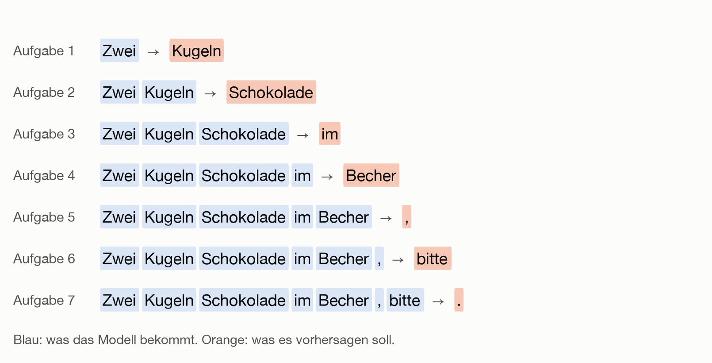
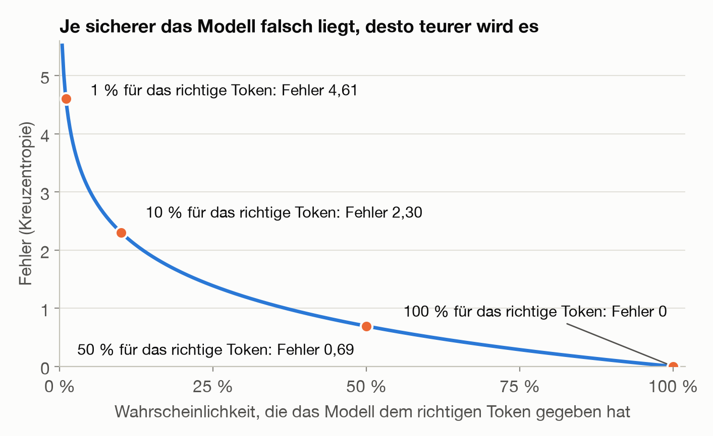
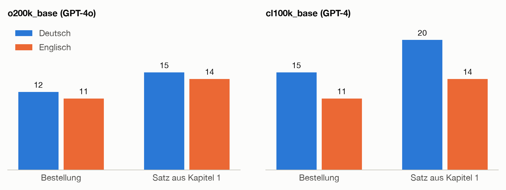
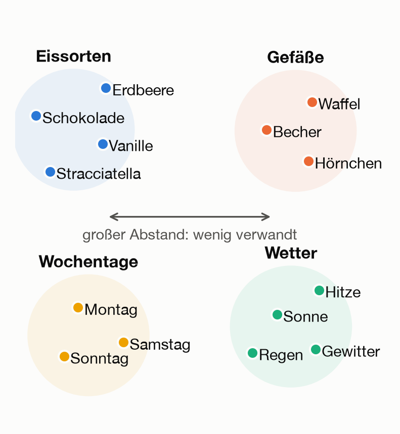
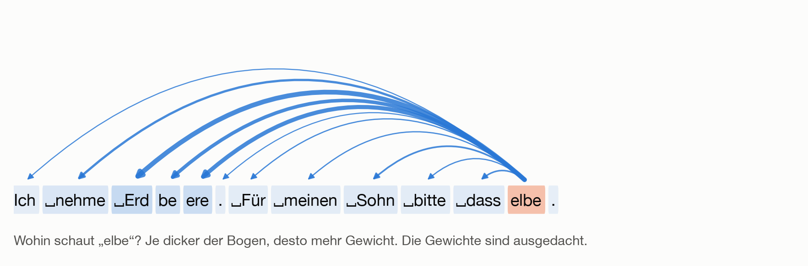
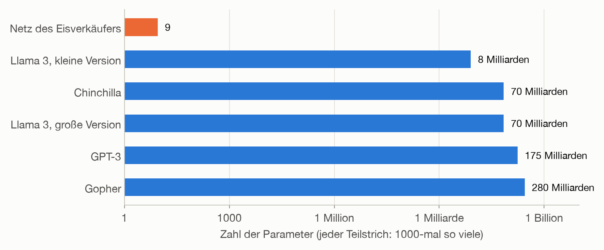
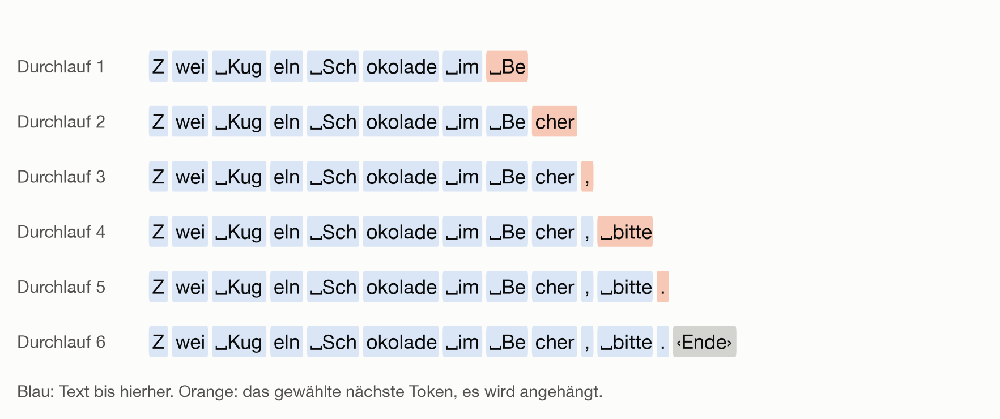
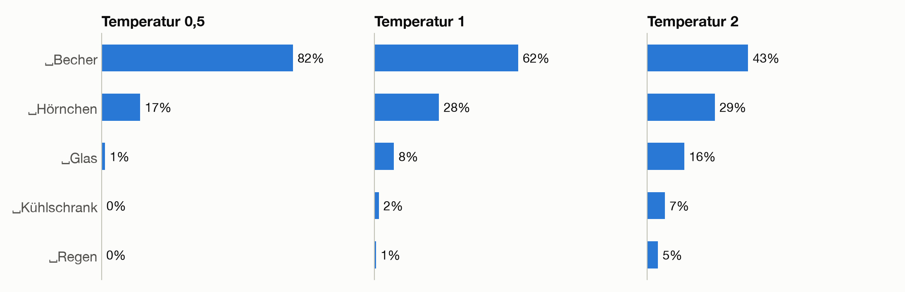

# Große Sprachmodelle: Wie ein Computer Texte schreibt

ChatGPT, Claude, Gemini: Viele haben schon mit einem Chat-Assistenten gearbeitet und gestaunt, wie flüssig er formuliert. Und manche haben erlebt, wie überzeugend er sich irren kann. Wie passt beides zusammen?

Dieses Kapitel zeigt, was in einem großen Sprachmodell (englisch Large Language Model, kurz LLM) steckt. Die überraschende Antwort: Es ist nach demselben Rezept gebaut wie das Netz des Eisverkäufers aus Kapitel 1. Eingaben gewichten, Fehler messen, Schritt für Schritt bergab gehen. Neu sind drei Dinge: Die Eingabe ist Text, die Vorhersage ist das nächste Stück Text, und alles ist um viele Größenordnungen größer.

<div class="lernziele" markdown="1">

**Nach diesem Kapitel kannst du …**

- erklären, dass ein Sprachmodell immer nur das nächste Textstück vorhersagt, und wie daraus ganze Antworten werden.
- beschreiben, was Tokens sind und warum sie Preis, Textlänge und manche seltsamen Fehler erklären.
- in groben Zügen sagen, wie ein Sprachmodell Bedeutung und Zusammenhänge im Text erfasst.
- einschätzen, wann du einer Antwort trauen kannst und wann du nachprüfen solltest.

Kästen „Für Neugierige“ enthalten Rechnungen und Hintergründe. Du kannst sie überspringen, ohne den Faden zu verlieren.

</div>

Was gleich bleibt und was neu ist:

| | Das Netz des Eisverkäufers | Ein großes Sprachmodell |
| --- | --- | --- |
| Eingabe | Temperatur und Wochenende | der bisherige Text, zerlegt in Tokens (Abschnitt 2) |
| Vorhersage | eine Zahl: verkaufte Kugeln | eine Wahrscheinlichkeit für jedes mögliche nächste Token |
| Parameter | 9 | viele Milliarden |
| Trainingsdaten | 18 Tage | Billionen Tokens |
| Lernverfahren | Gradientenabstieg und Backpropagation | dasselbe |

## 1. Was kommt als Nächstes?

Kennst du die Wortvorschläge auf der Tastatur deines Smartphones? Nach „Bis“ schlägt sie „morgen“ oder „später“ vor. Ein Sprachmodell macht im Grunde dasselbe, nur unvergleichlich besser.

<div class="frage" markdown="1">

**Kurz überlegen:** Wie geht dieser Satz weiter? „Zwei Kugeln Schokolade im …“

<details markdown="1">
<summary>Auflösung</summary>

Wahrscheinlich hast du an „Becher“ gedacht, vielleicht auch an „Hörnchen“. An „Regen“ eher nicht, obwohl auch das ein möglicher Satz wäre. Du hast gerade getan, was ein Sprachmodell tut: aus Erfahrung abgeschätzt, welche Fortsetzungen wie wahrscheinlich sind.

</details>
</div>

Ein Sprachmodell bekommt den bisherigen Text und gibt für jedes mögliche nächste Stück eine Wahrscheinlichkeit an:

```text
Zwei Kugeln Schokolade im  →  Becher 62 %, Hörnchen 28 %, Glas 8 %, …
```

Die Prozentzahlen sind ausgedacht. Zur Auswahl stehen dabei nicht drei Wörter, sondern das ganze Vokabular des Modells, oft 100.000 Einträge und mehr.

**Trainingsdaten gibt es umsonst.** Der Eisverkäufer musste seine Verkäufe aufschreiben. Ein Text dagegen ist schon eine Sammlung fertiger Übungsaufgaben, denn an jeder Stelle ist bekannt, wie es weitergeht:



Niemand muss etwas beschriften. Deshalb kann man mit riesigen Textmengen aus Büchern, Webseiten und Programmcode trainieren. Das nennt man **selbstüberwachtes Lernen**.

**Wie wird der Fehler gemessen?** Zwischen „Becher“ und „Glas“ gibt es keinen Abstand wie zwischen 270 und 320 Kugeln. Stattdessen fragt man: Wie überrascht war das Modell? Hat es dem Wort, das tatsächlich kam, eine hohe Wahrscheinlichkeit gegeben, ist der Fehler klein. Hielt es das Wort für unwahrscheinlich, ist der Fehler groß. Das Fachwort für dieses Fehlermaß ist **Kreuzentropie**.

<details class="vertiefung" markdown="1">
<summary>Für Neugierige: Wahrscheinlichkeiten und Kreuzentropie</summary>

Die letzte Schicht des Modells liefert für jeden Eintrag im Vokabular eine Punktzahl. Die **Softmax-Funktion** macht daraus Wahrscheinlichkeiten, die zusammen 100 % ergeben: Höhere Punktzahlen bekommen überproportional mehr Wahrscheinlichkeit.

Die Kreuzentropie ist der negative Logarithmus der Wahrscheinlichkeit, die das Modell dem richtigen Token gegeben hat:



Wie beim Quadrieren in Kapitel 1 kosten grobe Fehlgriffe besonders viel. Und auch diese Kurve ist glatt, der Gradientenabstieg funktioniert also wie gehabt.

</details>

> **Merke:** Ein Sprachmodell sagt immer nur das nächste Stück Text voraus. Jeder Text liefert dafür seine Übungsaufgaben selbst.

## 2. Text in Zahlen: der Tokenizer

Netze rechnen nur mit Zahlen. In Kapitel 1 wurde deshalb aus dem Wochenende eine 0 oder 1. Für Text erledigt das der **Tokenizer**: Er zerlegt Text in Stücke, die **Tokens**, und gibt jedem Stück eine Nummer.

Doch wie groß sollen die Stücke sein?

| Zerlegen in      | Vorteil                            | Nachteil                                              |
| ---------------- | ---------------------------------- | ----------------------------------------------------- |
| einzelne Zeichen | kleines Vokabular, jeder Text geht | sehr lange Folgen                                     |
| ganze Wörter     | kurze Folgen                       | riesiges Vokabular, unbekannte Wörter gehen gar nicht |
| Teilwörter       | der Kompromiss aus beidem          | die Stücke wirken manchmal willkürlich                |

Heutige Sprachmodelle verwenden Teilwörter. Der Tokenizer lernt sein Vokabular dabei selbst: Er beginnt mit einzelnen Zeichen und fasst Schritt für Schritt das Paar zusammen, das am häufigsten nebeneinander vorkommt. So sieht das aus, wenn man ihn an sechs Eisbestellungen wie „zwei kugeln schoko im becher“ lernen lässt:


Häufige Wörter wie „kugeln“ werden schnell zu einem einzigen Token, seltene wie „vanille“ bleiben in Stücken. Echte Tokenizer machen dasselbe mit riesigen Textmengen und hören erst bei 100.000 oder 200.000 Tokens auf.

<details class="vertiefung" markdown="1">
<summary>Für Neugierige: Byte-Pair-Encoding</summary>

Das Verfahren heißt **Byte-Pair-Encoding**. Echte Tokenizer beginnen nicht bei Buchstaben, sondern bei den 256 möglichen Bytes, den Grundbausteinen, aus denen ein Computer jeden Text zusammensetzt. Deshalb können sie jeden Text zerlegen, auch Tippfehler, fremde Schriften und Emojis.

</details>

> **Merke:** Der Tokenizer zerlegt Text in Teilwörter und gibt ihnen Nummern. Er wird einmal vorab gelernt und bleibt danach fest. Er ist die Brille, durch die das Modell jeden Text sieht.

## 3. Ein echter Tokenizer bei der Arbeit

Wie das in der Praxis aussieht, zeigt der Tokenizer, den OpenAI für GPT-4o verwendet und frei zur Verfügung stellt. Andere Modellfamilien wie Claude, Gemini oder Llama haben eigene Tokenizer, das Prinzip ist dasselbe. So zerlegt er eine Bestellung:


Das Zeichen ␣ steht für ein Leerzeichen. An solchen Zerlegungen sieht man einiges:

| Beobachtung | Beispiel | Folge |
| --- | --- | --- |
| Das Leerzeichen gehört zum Wort | `␣Kugeln` → `␣Kug` `eln`, aber `Kugeln` am Satzanfang → `K` `ug` `eln` | Dasselbe Wort kann ganz verschieden aussehen. |
| Häufig heißt ganz | `␣bitte` und `␣verkauft` sind je ein Token, `Erdbeere` am Satzanfang → `E` `rd` `be` `ere` | Seltene Wörter kosten mehr Tokens. |
| Zahlen kommen in Blöcken | `12345678` → `123` `456` `78` | Rechnen mit langen Zahlen ist schwer. |
| Die Nummern bedeuten nichts | `␣Kug` ist 110582, `␣bitte` ist 49309 | Wie bei den Wochentag-Nummern in Kapitel 1 sagt die Größe nichts aus. |

<div class="frage" markdown="1">

**Kurz überlegen:** Chat-Assistenten tun sich überraschend schwer mit der Frage „Wie viele r stecken in Erdbeere?“. Warum?

<details markdown="1">
<summary>Auflösung</summary>

Das Modell sieht keine Buchstaben. Bei „…&nbsp;in Erdbeere?“ kommt das Wort als drei Nummern an: 104051, 1464 und 512, die für `␣Erd`, `be` und `ere` stehen. Wie viele r darin stecken, muss das Modell irgendwann einmal nebenbei gelernt haben. Ablesen kann es das nicht.

</details>
</div>

**Deutsch ist teurer als Englisch.** Für denselben Inhalt braucht Deutsch mehr Tokens, und ältere Tokenizer mit kleinerem Vokabular trifft es stärker:



Das hat praktische Folgen, denn bei Sprachmodellen wird fast alles in Tokens gemessen: der Preis einer Anfrage, die Geschwindigkeit der Antwort und wie viel Text das Modell auf einmal überblicken kann (Abschnitt 9). Als grobe Faustregel entspricht ein Token im Deutschen etwa einem Wortteil, ein Wort hat oft ein bis drei Tokens.

<details class="vertiefung" markdown="1">
<summary>Für Neugierige: Die beiden Vokabulare im Vergleich</summary>

Die frei verfügbare Bibliothek heißt **tiktoken**. Die Grafiken zeigen zwei ihrer Vokabulare:

| Vokabular     | Tokens im Vokabular | Verwendet unter anderem für |
| ------------- | ------------------- | --------------------------- |
| `o200k_base`  | 200.019             | GPT-4o                      |
| `cl100k_base` | 100.277             | GPT-4 und GPT-3.5           |

Alle Beispiele in der Tabelle oben stammen von `o200k_base`.

</details>

> **Merke:** Tokens sind die Währung von Sprachmodellen. Wer weiß, wie ein Text zerlegt wird, versteht viele seltsame Schwächen, etwa beim Buchstabenzählen und Rechnen.

## 4. Bedeutung als Zahlenliste: Embeddings

Eine Token-Nummer allein sagt nichts über die Bedeutung. Deshalb bekommt jedes Token eine eigene Liste von Zahlen, ein **Embedding**. Bei großen Modellen hat sie einige tausend Einträge.

Diese Zahlen sind ganz gewöhnliche Parameter: Am Anfang sind sie zufällig, beim Training werden sie mit dem Gradientenabstieg angepasst, wie das Wochenend-Weight in Kapitel 1. Weil das Ziel nur ist, das nächste Token gut vorherzusagen, landen Wörter, die in ähnlichen Zusammenhängen vorkommen, bei ähnlichen Zahlenlisten. Man kann sich das wie eine Landkarte der Bedeutung vorstellen:



Die Karte ist vereinfacht: Echte Embeddings haben tausende Dimensionen, nicht zwei, und die Positionen hier sind ausgedacht. Das Prinzip stimmt aber, und niemand hat es dem Modell gesagt. Es ergibt sich aus den Daten.

<details class="vertiefung" markdown="1">
<summary>Für Neugierige: Wie groß diese Tabelle wird</summary>

Bei 200.000 Tokens mit je 4.000 Zahlen sind es schon 800 Millionen Parameter, nur für die Embeddings. Zusätzlich bekommt das Modell mit, an welcher Stelle ein Token steht. Sonst wäre „Hund beißt Mann“ dasselbe wie „Mann beißt Hund“.

</details>

> **Merke:** Embeddings übersetzen Token-Nummern in Bedeutung: Ähnliches liegt nah beieinander.

## 5. Ein Wort reicht nicht: Attention

Zum Vorhersagen genügt das letzte Wort selten. Ein Kunde sagt: „Ich nehme Erdbeere. Für meinen Sohn bitte dasselbe.“ Um „dasselbe“ zu verstehen, muss man weit zurückschauen. Und in einem anderen Satz steht das wichtige Wort an einer ganz anderen Stelle.

<div class="frage" markdown="1">

**Kurz überlegen:** Worauf bezieht sich „sie“ in diesem Satz? „Die Kugel passt nicht in die Waffel, weil sie zu groß ist.“

<details markdown="1">
<summary>Auflösung</summary>

Auf die Kugel. Ändert man „zu groß“ in „zu klein“, ist plötzlich die Waffel gemeint. Grammatisch ginge beides, entscheiden kann man es nur, wenn man mehrere Wörter gleichzeitig im Blick hat. Genau dafür gibt es Attention.

</details>
</div>

Die Lösung heißt **Attention** (Aufmerksamkeit). Jedes Token schaut auf die Tokens vor sich und entscheidet, wie wichtig ihm jedes davon gerade ist. Von den wichtigen holt es sich mehr Information, von den unwichtigen weniger:



Die Gewichte in der Grafik sind ausgedacht. Wichtig ist der Unterschied zu Kapitel 1: Diese Gewichtung ist kein fester Parameter, sie wird für jeden Text neu berechnet. Gelernt wird nur, *wie* sie berechnet wird.

<details class="vertiefung" markdown="1">
<summary>Für Neugierige: Zwei Einzelheiten</summary>

- Jedes Token schaut nur auf frühere Tokens, sonst könnte das Modell beim Training die Lösung einfach abschreiben.
- Ein Satz enthält viele Beziehungen gleichzeitig: wer bestellt, was bestellt wird, worauf sich ein Wort bezieht. Deshalb rechnet das Modell mehrere Gewichtungen parallel, die **Attention-Köpfe**, und jeder lernt, auf andere Zusammenhänge zu achten.

Man kann sich Attention wie ein Neuron vorstellen, dessen Weights vom Input abhängen.

</details>

> **Merke:** Attention lässt jedes Wort auf die früheren schauen, und zwar für jeden Text mit neuen Gewichten. So erfasst das Modell Zusammenhänge über viele Wörter hinweg.

## 6. Der Transformer

Die Bauweise heutiger Sprachmodelle heißt **Transformer**. Das „T“ in „GPT“ steht dafür. Sie wurde 2017 von Forschenden bei Google vorgestellt. Der Weg vom Text zum nächsten Token sieht so aus:


Das Herzstück ist der Block, und große Modelle stapeln Dutzende davon. Jeder Block hat zwei Teile:

1. **Attention:** Die Tokens tauschen Informationen untereinander aus (Abschnitt 5).
2. **Neuronen mit Knick:** Jedes Token wird für sich weiterverarbeitet. Das ist die verborgene Schicht aus Kapitel 1, nur mit tausenden Neuronen statt zwei.

Gelernt wird wie in Kapitel 1: Vorhersage berechnen, Fehler messen, mit Backpropagation die Steigungen bestimmen, einen Schritt bergab gehen. Nur geschieht das nicht 30000-mal mit 18 Tagen, sondern für Billionen von Tokens, verteilt auf tausende Spezialchips über Wochen oder Monate.

<details class="vertiefung" markdown="1">
<summary>Für Neugierige: Was sonst noch im Transformer steckt</summary>

Der Artikel, der den Transformer vorstellte, heißt „Attention Is All You Need“. Heutige Modelle verwenden meist einen leicht abgerundeten Knick, die Aufgabe ist dieselbe wie in Kapitel 1. Dazu kommen technische Hilfsmittel, die das Training vieler Schichten stabil halten. Die meisten Parameter stecken in den Neuronen der Blöcke.

</details>

> **Merke:** Ein Transformer ist ein Stapel aus Attention und den bekannten Neuronen mit Knick, trainiert mit dem bekannten Gradientenabstieg.

## 7. Skalierung: Warum größer besser wird

Ein Sprachmodell lässt sich an drei Stellschrauben vergrößern: mehr **Parameter**, mehr **Daten** und mehr **Rechenaufwand**. Wie groß die Unterschiede sind, zeigt eine Achse, auf der jeder Teilstrich tausendmal so viel bedeutet wie der vorige:



Drei Erkenntnisse aus der Forschung:

- **Der Fehler sinkt vorhersagbar.** Mit mehr Parametern, Daten oder Rechenaufwand sinkt der Fehler sehr regelmäßig. Deshalb kann man an kleinen Modellen ausprobieren und recht zuverlässig vorhersagen, wie gut ein großes wird.
- **Daten und Parameter gehören zusammen.** Ein großes Modell braucht auch entsprechend viele Daten. Ein kleineres Modell mit mehr Daten kann ein größeres schlagen.
- **Fähigkeiten kommen nebenbei.** Um Text wirklich gut fortzusetzen, muss ein Modell Grammatik, Fakten, Übersetzungen und Programmcode lernen. Niemand bringt ihm das gezielt bei, es steckt in der Aufgabe „nächstes Token“.

**Und das Auswendiglernen aus Kapitel 1?** Dort lernte ein Modell mit vielen Parametern für wenige Tage nur auswendig. Ein großes Sprachmodell hat zwar Milliarden Parameter, sieht aber noch viel mehr Text, das meiste davon nur ein einziges Mal. Ganz verschwindet das Auswendiglernen trotzdem nicht: Sehr häufige Texte kann ein Modell manchmal wörtlich wiedergeben.

<details class="vertiefung" markdown="1">
<summary>Für Neugierige: Die Studien dahinter</summary>

- 2020 zeigten Forschende von OpenAI, dass der Fehler nach einem einfachen Potenzgesetz sinkt, und zwar über mehr als sieben Größenordnungen.
- 2022 zeigte DeepMind, dass Modellgröße und Datenmenge gleich stark wachsen sollten: Doppelt so viele Parameter brauchen doppelt so viele Trainingstokens. Das Modell Chinchilla hatte nur ein Viertel der Größe von Gopher (70 statt 280 Milliarden Parameter), bekam bei gleichem Rechenaufwand aber viermal so viele Daten und schnitt durchweg besser ab, auch als GPT-3.
- Llama 3 wurde mit über 15 Billionen Tokens trainiert. Geprüft wird auch hier, wie in Kapitel 1, an Texten, die das Modell beim Training nicht gesehen hat.

</details>

> **Merke:** Größer wird besser, wenn Parameter und Daten gemeinsam wachsen, und zwar erstaunlich vorhersagbar.

## 8. Text erzeugen

Ein Sprachmodell sagt immer nur ein einziges nächstes Token voraus. Längere Antworten entstehen in einer Schleife: vorhersagen, ein Token auswählen, anhängen, wieder von vorn. Das geht so lange, bis das Modell ein spezielles Ende-Token wählt:



Deshalb erscheinen Antworten im Chat Stück für Stück. Für jedes Token läuft das ganze Modell einmal durch. Das ist die Anwendung aus Kapitel 1: Die Weights bleiben fest, das Modell rechnet nur noch.

**Wie wird ausgewählt?** Nimmt das Modell immer das wahrscheinlichste Token, werden Texte eintönig und wiederholen sich. Deshalb wird meist ausgelost, und zwar so, dass wahrscheinliche Tokens öfter gezogen werden. Darum gibt dasselbe Modell auf dieselbe Frage nicht immer dieselbe Antwort.

**Die Temperatur** ist eine Stellschraube beim Auslosen. Mit der Temperatur aus Kapitel 1 hat sie nichts zu tun, auch wenn es beim Eisverkäufer gut passt. Bei niedriger Temperatur gewinnt fast immer der Favorit, bei hoher Temperatur bekommen auch Außenseiter eine Chance. In der Grafik sind die Kandidaten der Einfachheit halber ganze Wörter, die Zahlen sind ausgedacht:



| Temperatur | Wirkung | Geeignet für |
| --- | --- | --- |
| niedrig, nahe 0 | fast immer das wahrscheinlichste Token, vorhersagbar und gleichförmig | Fakten, Code, Zusammenfassungen |
| hoch | Wahrscheinlichkeiten gleichen sich an, abwechslungsreich, aber fehleranfälliger | Ideen sammeln, kreatives Schreiben |

Bei hoher Temperatur hat plötzlich selbst „Zwei Kugeln Schokolade im Regen“ eine echte Chance.

<details class="vertiefung" markdown="1">
<summary>Für Neugierige: Was die Temperatur genau macht</summary>

Vor der Softmax-Funktion (Abschnitt 1) werden alle Punktzahlen durch die Temperatur geteilt. Eine Temperatur unter 1 vergrößert die Abstände zwischen den Punktzahlen, der Favorit wird noch wahrscheinlicher. Eine Temperatur über 1 verkleinert sie, die Wahrscheinlichkeiten gleichen sich an. In Chat-Assistenten ist die Temperatur meist fest eingestellt, über die Programmierschnittstellen der Anbieter lässt sie sich wählen.

</details>

> **Merke:** Text entsteht Token für Token. Die Temperatur bestimmt, wie mutig dabei ausgelost wird.

## 9. Vom Textvervollständiger zum Assistenten

Nach dem **Vortraining** mit riesigen Textmengen kann ein Modell Text fortsetzen, ist aber noch kein hilfreicher Assistent. Erst zwei weitere Trainingsschritte machen einen daraus. Die Antworten in der Grafik sind ausgedacht, zeigen aber den typischen Unterschied:


1. **Feinabstimmung:** Das Modell wird mit vielen Beispielgesprächen weitertrainiert, in denen auf eine Anfrage eine gute Antwort folgt. Das Verfahren bleibt gleich, nur die Daten ändern sich.
2. **Lernen aus menschlichem Feedback:** Menschen vergleichen Antworten des Modells und wählen die bessere. Das Modell wird so weitertrainiert, dass bevorzugte Antworten wahrscheinlicher werden. Das wirkt stark: Ein so trainiertes Modell mit 1,3 Milliarden Parametern wurde dem hundertmal größeren GPT-3 vorgezogen.

<div class="frage" markdown="1">

**Kurz überlegen:** Lernt ein Chat-Assistent aus deinem Gespräch dazu?

<details markdown="1">
<summary>Auflösung</summary>

Nicht während des Gesprächs. Die Weights bleiben fest. Der Assistent „erinnert“ sich nur, weil ihm bei jeder Antwort das ganze bisherige Gespräch als Text mitgeschickt wird. Manche Assistenten speichern zusätzlich Notizen über dich und schicken sie in neuen Gesprächen mit, auch das ist kein Lernen im Sinne von Kapitel 1. Unabhängig davon können Anbieter Gespräche später für das Training neuer Modelle verwenden, je nach Vertrag und Einstellungen.

</details>
</div>

Der Text, den das Modell bei jeder Antwort bekommt, hat eine Obergrenze, das **Kontextfenster**. Auch sie wird in Tokens gemessen. Ist ein Gespräch oder ein Dokument zu lang, fällt etwas heraus.

> **Merke:** Vortraining bringt das Wissen, Feinabstimmung und Feedback bringen das hilfreiche Verhalten. Im Gespräch lernt das Modell nicht dazu, es liest nur mit.

## 10. Grenzen ehrlich benennen

Aus dem, was ein Sprachmodell lernt, folgen auch seine typischen Schwächen:

| Schwäche | Warum | Was hilft |
| --- | --- | --- |
| **Plausibel statt wahr** (Halluzination) | Das Modell lernt, welcher Text wahrscheinlich folgt, nicht welcher stimmt. Wo die Daten wenig hergeben, klingt es trotzdem überzeugend. | Wichtige Aussagen prüfen, Quellen verlangen und nachsehen |
| **Nur, was in den Daten steckt** | Es kennt die Welt nur bis zum Ende seiner Trainingsdaten und übernimmt deren Einseitigkeiten. | Aktuelle Informationen im Gespräch mitgeben |
| **Die Brille des Tokenizers** | Es sieht Tokens, keine Buchstaben oder Ziffern (Abschnitt 3). | Für Zählen und Rechnen ein Werkzeug nutzen |
| **Zufall beim Erzeugen** | Durch das Auslosen bekommt dieselbe Frage verschiedene Antworten (Abschnitt 8). | Ergebnis prüfen, bei Bedarf mehrmals fragen |

Die Halluzination ist dabei dasselbe Problem wie in Kapitel 1, als die Gerade bei −10 °C selbstbewusst −60 Kugeln vorhersagte: Außerhalb seiner Daten rechnet ein Modell einfach weiter. Es hat keine eingebaute Warnlampe für „Das weiß ich nicht“.

> **Merke:** Ein Sprachmodell erzeugt plausiblen Text, nicht zwingend wahren.

## 11. Was das für den Alltag heißt

Aus diesem Kapitel lassen sich einige Faustregeln für die Arbeit mit Chat-Assistenten ableiten:

- **Kontext mitgeben.** Das Modell weiß nur, was in seinen Trainingsdaten stand und was im Gespräch steht. Wer Zweck, Zielgruppe und nötige Fakten nennt, bekommt passendere Antworten.
- **Fakten prüfen.** Zahlen, Namen, Zitate und Quellenangaben sind typische Stellen für Halluzinationen. Je wichtiger die Antwort, desto gründlicher der Blick in eine verlässliche Quelle.
- **Für Rechnen und Zählen Werkzeuge nutzen.** Viele Assistenten können dafür ein Rechenprogramm aufrufen. Sonst lieber selbst nachrechnen.
- **Lange Texte im Blick behalten.** Bei sehr langen Gesprächen oder Dokumenten stößt das Modell an sein Kontextfenster. Ein neues Gespräch mit einer kurzen Zusammenfassung hilft oft.
- **Bewusst entscheiden, was du eingibst.** Alles, was du eintippst, wird an den Anbieter geschickt. Vertrauliche Daten gehören nur in Dienste, die dafür freigegeben sind.

> **Merke:** Ein Chat-Assistent ist ein starkes Werkzeug zum Formulieren, Zusammenfassen und Ideensammeln. Für Fakten ist er ein guter Ausgangspunkt, aber keine Quelle.

## Das Wichtigste in Kürze

- Ein Sprachmodell sagt immer nur das **nächste Token** voraus, als Wahrscheinlichkeit für jedes Token im Vokabular. Gelernt wird wie in Kapitel 1 mit Gradientenabstieg.
- Jeder Text liefert seine Übungsaufgaben selbst. Deshalb kann man mit riesigen Datenmengen trainieren.
- Der **Tokenizer** zerlegt Text in Teilwörter und gibt ihnen Nummern. Tokens bestimmen Preis, Geschwindigkeit und wie viel Text das Modell überblickt. Buchstaben und Ziffern sieht das Modell nur in Stücken.
- **Embeddings** machen aus jedem Token eine gelernte Zahlenliste. Ähnliche Wörter bekommen ähnliche Listen.
- **Attention** lässt jedes Token auf frühere Tokens schauen. Ein **Transformer** stapelt viele Blöcke aus Attention und Neuronen mit Knick.
- Größere Modelle mit mehr Daten werden vorhersagbar besser.
- Antworten entstehen **Token für Token** durch Auslosen. Die **Temperatur** bestimmt, wie vorhersagbar oder abwechslungsreich das Ergebnis wird.
- Aus einem Textvervollständiger wird durch **Feinabstimmung** und **menschliches Feedback** ein Assistent. Im Gespräch lernt er nicht dazu.
- Ein Sprachmodell erzeugt plausiblen Text, nicht zwingend wahren.

## Teste dich

<details class="quiz" markdown="1">
<summary>Woher bekommt ein Sprachmodell seine Trainingsaufgaben?</summary>

Aus dem Text selbst: An jeder Stelle eines Textes ist bekannt, welches Token als Nächstes kommt. Niemand muss etwas beschriften.

</details>

<details class="quiz" markdown="1">
<summary>Warum kostet derselbe Inhalt auf Deutsch oft mehr als auf Englisch?</summary>

Vor allem, weil Englisch in den Texten, an denen der Tokenizer gelernt hat, viel häufiger vorkommt. Häufige Wörter werden zu einem einzigen Token (Abschnitt 2), deutsche Wörter zerfallen deshalb öfter in mehrere Stücke. Und abgerechnet wird nach Tokens.

</details>

<details class="quiz" markdown="1">
<summary>Warum gibt ein Chat-Assistent auf dieselbe Frage manchmal verschiedene Antworten?</summary>

Weil das nächste Token jedes Mal ausgelost wird, entsprechend den Wahrscheinlichkeiten. Wie stark der Zufall wirkt, hängt von der Temperatur ab.

</details>

<details class="quiz" markdown="1">
<summary>Wie „merkt“ sich ein Assistent, was du vorhin im Gespräch geschrieben hast?</summary>

Gar nicht im Modell selbst. Bei jeder Antwort wird ihm das bisherige Gespräch als Text mitgeschickt, bis zur Grenze des Kontextfensters.

</details>

<details class="quiz" markdown="1">
<summary>Warum kann ein Sprachmodell überzeugend klingen und trotzdem falsch liegen?</summary>

Es wurde darauf trainiert, wahrscheinlichen Text zu erzeugen, nicht wahren. Wo seine Daten wenig hergeben, erzeugt es trotzdem flüssigen, plausiblen Text (Halluzination).

</details>

## Wie es weitergeht

Zwei Gedanken aus diesem Kapitel lassen sich weiterführen. Wenn Embeddings ähnliche Bedeutung in ähnliche Zahlen übersetzen, kann man damit auch ganze Texte vergleichen und nach Bedeutung suchen statt nach Wörtern. Und wenn ein Sprachmodell nur weiß, was in seinen Trainingsdaten steckt, kann man ihm passende Texte heraussuchen und mitgeben.

Beides zeigt [Kapitel 3](03-Semantische-Suche-und-RAG.md).

## Selbst ausprobieren

In [Labor 2](app/labor-2.html) lässt sich beliebiger Text eintippen und sofort in Tokens zerlegen, mit denselben Tokenizern wie in diesem Kapitel. Außerdem lässt sich die Temperatur aus Abschnitt 8 frei einstellen und beim Auslosen beobachten. Das Labor läuft direkt im Browser, auch ohne Internetverbindung.

<details class="vertiefung" markdown="1">
<summary>Für technisch Interessierte: Alles selbst nachrechnen</summary>

Ein Python-Skript zerlegt eigene Texte. Dafür wird [uv](https://docs.astral.sh/uv/) benötigt. Beim ersten Start lädt tiktoken die Vokabulare aus dem Internet und speichert sie, danach geht es auch offline. Für einen Workshop sollte man es deshalb vorher einmal starten.

```bash
uv run docs/beispiele/02_tokenizer.py "Drei Kugeln Vanille, bitte."
```

Ohne eigenen Text rechnet das Skript alle Beispiele dieses Kapitels nach, auch den Mini-Tokenizer aus Abschnitt 2, und erzeugt alle Grafiken sowie die Daten für das Labor neu. Im Labor arbeitet js-tiktoken, eine Umsetzung von tiktoken für den Browser, die exakt dieselben Tokens liefert.

</details>

## Quellen

- Vaswani u. a. (2017): [Attention Is All You Need](https://arxiv.org/abs/1706.03762)
- Kaplan u. a. (2020): [Scaling Laws for Neural Language Models](https://arxiv.org/abs/2001.08361)
- Brown u. a. (2020): [Language Models are Few-Shot Learners](https://arxiv.org/abs/2005.14165) (GPT-3)
- Hoffmann u. a. (2022): [Training Compute-Optimal Large Language Models](https://arxiv.org/abs/2203.15556) (Chinchilla)
- Ouyang u. a. (2022): [Training language models to follow instructions with human feedback](https://arxiv.org/abs/2203.02155)
- Meta (2024): [Introducing Meta Llama 3](https://ai.meta.com/blog/meta-llama-3/)
- OpenAI: [tiktoken](https://github.com/openai/tiktoken)
