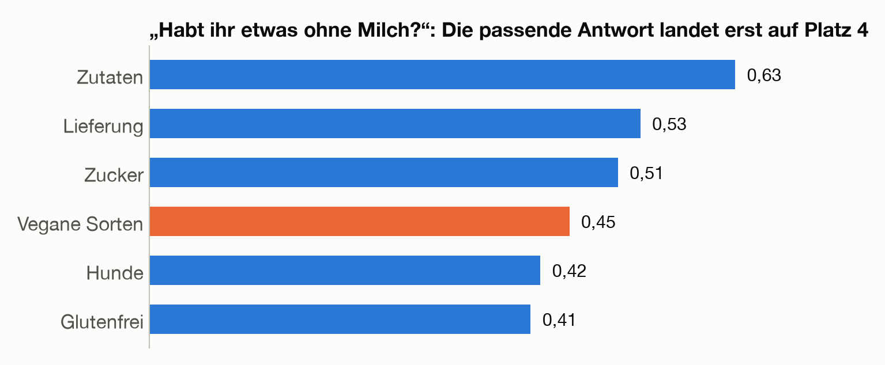

# Suchen nach Bedeutung: Wie eine KI in Dokumenten nachschlägt

Viele Organisationen möchten einen Chat-Assistenten, der Fragen zu ihren eigenen Unterlagen beantwortet, etwa zu einem Handbuch, zu internen Regeln oder zu Produktbeschreibungen. Ein Sprachmodell kennt diese Unterlagen nicht, und es damit neu zu trainieren wäre teuer.

Üblich ist deshalb ein Weg aus zwei Bausteinen: eine Suche nach Bedeutung, die **semantische Suche**, und ein Verfahren namens **RAG**, das dem Sprachmodell die gefundenen Textstellen vor der Antwort mitgibt. Beides baut auf den Embeddings aus Kapitel 2 auf.

<div class="lernziele" markdown="1">

**Nach diesem Kapitel kannst du …**

- erklären, warum eine Suche nach Bedeutung mehr findet als eine Suche nach Stichwörtern.
- in eigenen Worten beschreiben, wie ein Computer die Ähnlichkeit zweier Texte misst.
- den Ablauf von RAG skizzieren und sagen, warum Antworten damit überprüfbar werden.
- typische Schwachstellen nennen und einschätzen, wann du genauer hinschauen solltest.

Kästen „Für Neugierige“ enthalten Rechnungen und Hintergründe. Für den Rest des Kapitels brauchst du sie nicht.

</div>

Zwei Arten von Modellen, die in diesem Kapitel zusammenarbeiten:

| | Sprachmodell (Kapitel 2) | Embedding-Modell (dieses Kapitel) |
| --- | --- | --- |
| Eingabe | der bisherige Text | ein kurzer Text, etwa eine Frage oder ein Absatz |
| Ausgabe | Wahrscheinlichkeiten für das nächste Token | eine Zahlenliste für den ganzen Text |
| Wozu | Text erzeugen | Texte vergleichen, suchen, sortieren |

Alle Ähnlichkeitswerte in diesem Kapitel sind echt. Sie wurden mit einem frei verfügbaren Embedding-Modell berechnet, das auch Labor 3 verwendet.

## 1. Suchen nach Bedeutung

Der Eisverkäufer hat ein Handbuch für seinen Stand geschrieben: 24 kurze Abschnitte über Sorten, Preise, Öffnungszeiten und Allergien. Es ist wie alle Daten im Workshop erfunden. Ein Kunde fragt:

```text
Mir tut der Kopf weh, wenn ich Eis esse.
```

<div class="frage" markdown="1">

**Kurz überlegen:** Du sollst die Antwort im Handbuch finden. Welche Wörter würdest du in eine Suchmaske eintippen?

<details markdown="1">
<summary>Auflösung</summary>

Im Handbuch steht die Antwort unter „Hirnfrost“:

```text
Hirnfrost: Wer sehr kaltes Eis zu schnell isst, bekommt manchmal kurz stechende Kopfschmerzen. Langsam essen hilft.
```

Wer das Wort „Hirnfrost“ nicht kennt, sucht vermutlich nach „Kopfschmerzen“ oder „Kopf“ und hofft auf einen Treffer. Ein Mensch weiß sofort, dass „Kopf tut weh“ und „Kopfschmerzen“ dasselbe meinen. Eine Stichwortsuche weiß das nicht.

</details>
</div>

Eine **Stichwortsuche** zählt, wie viele Wörter der Frage in einem Abschnitt vorkommen. Füllwörter wie „der“ oder „ich“ lässt sie weg. Im Hirnfrost-Abschnitt findet sie nur „Eis“, denn „Kopf“ ist nicht „Kopfschmerzen“, und „esse“ ist nicht „isst“. Das Wort „Eis“ steht aber in sieben Abschnitten, und alle liegen gleichauf.

Die semantische Suche dagegen setzt „Hirnfrost“ mit großem Abstand an die Spitze:


Weitere Beispiele:

| Frage | Im Handbuch steht | Stichwortsuche | Semantische Suche |
| --- | --- | --- | --- |
| Kann ich mit dem Handy bezahlen? | „… kontaktlos mit dem Smartphone“ | findet es über „bezahlen“ | findet es (0,80) |
| Darf mein Hund mit? | „Hunde sind willkommen.“ | findet nichts | findet es (0,61) |
| Bekomme ich eine Kugel umsonst? | „… ist die nächste Kugel gratis“ | wählt „Zucker“ | findet es (0,51) |
| Do you have vegan ice cream? | „Alle Fruchtsorbets sind vegan …“ | findet es über „vegan“ | findet es (0,51) |

Die Zahlen in Klammern messen die Ähnlichkeit, 1 wäre das Höchste. Wie sie entstehen, zeigen die nächsten beiden Abschnitte.

> **Merke:** Die Stichwortsuche vergleicht Buchstabenfolgen, die semantische Suche vergleicht Bedeutungen.

## 2. Ein Text, ein Pfeil

Die Idee aus Kapitel 2 lässt sich auf ganze Texte übertragen: Jeder Text bekommt eine Liste von Zahlen, sein **Embedding**. Texte mit ähnlicher Bedeutung sollen ähnliche Listen bekommen.

Zum Verstehen genügen zwei Zahlen pro Text. Die erste soll messen, wie sehr es um Geld geht, die zweite, wie sehr um Gesundheit. Diese Werte sind ausgedacht:

| | Text | Zahl 1: Geld | Zahl 2: Gesundheit |
| --- | --- | --- | --- |
| F | Frage: „Was kostet eine Kugel?“ | 3 | 1 |
| P | Abschnitt „Preise: Eine Kugel kostet 1,80 Euro …“ | 6 | 2 |
| H | Abschnitt „Hirnfrost: Wer sehr kaltes Eis …“ | 1 | 3 |

Zwei Zahlen sind ein Punkt in einem Koordinatensystem. Zeichnet man vom Nullpunkt einen Pfeil zu diesem Punkt, erhält man einen **Vektor**:


Der Preise-Abschnitt zeigt in genau dieselbe Richtung wie die Frage, sein Pfeil ist nur länger, weil er mehr über Geld sagt. Der Hirnfrost-Abschnitt zeigt in eine ganz andere Richtung. Für die Suche zählt also die Richtung, nicht die Länge.

Echte Embeddings funktionieren genauso, nur mit viel mehr Zahlen. Das Modell aus diesem Kapitel macht aus „Was kostet eine Kugel?“ eine Liste mit 384 Zahlen. Anders als im ausgedachten Beispiel bedeutet keine dieser Zahlen etwas für sich allein. Bedeutung hat nur das Muster aller 384 Zahlen zusammen. Sichtbar wird das, wenn man jede Zahl als Farbstreifen zeichnet:


Vorstellen kann man sich einen Pfeil mit 384 Zahlen nicht, rechnen lässt sich damit aber genauso wie mit zwei.

> **Merke:** Ein Embedding macht aus einem ganzen Text einen Pfeil. Ähnliche Bedeutung heißt: ähnliche Richtung.

## 3. Ähnlichkeit messen: der Kosinus

Wie ähnlich zwei Richtungen sind, misst der **Kosinus** des Winkels zwischen den Pfeilen. Den Begriff kennen manche aus dem Matheunterricht. Für dieses Kapitel genügt diese Tabelle:

| Kosinus | Winkel | Bedeutung |
| --- | --- | --- |
| 1 | 0° | gleiche Richtung |
| 0 | 90° | nichts gemeinsam |
| −1 | 180° | entgegengesetzte Richtung |

Für die Frage F und den Preise-Abschnitt P ergibt sich 1,00, denn sie zeigen in exakt dieselbe Richtung. Für die Frage F und den Hirnfrost-Abschnitt H ergibt sich 0,60. Der Preise-Abschnitt gewinnt also, wie es sein soll.

Man könnte auch den Abstand zwischen den Pfeilspitzen messen. Die Spitze von H liegt mit 2,83 aber näher an F als die Spitze von P mit 3,16. Nach dem Abstand wäre der Hirnfrost-Abschnitt die bessere Antwort auf die Preisfrage, und das ist falsch. Der Abstand wird von der Länge der Pfeile gestört, der Kosinus nicht.

<details class="vertiefung" markdown="1">
<summary>Für Neugierige: Den Kosinus ausrechnen</summary>

Der Kosinus lässt sich in drei Schritten ausrechnen, ganz ohne Winkelmesser:

1. **Skalarprodukt:** Die Zahlen an gleicher Stelle multiplizieren und alles addieren.
2. **Längen:** Für jeden Pfeil die Zahlen quadrieren, addieren und die Wurzel ziehen (der Satz des Pythagoras).
3. **Teilen:** Skalarprodukt geteilt durch das Produkt der beiden Längen.

Für die Frage F und den Preise-Abschnitt P:

```text
Skalarprodukt:  3 · 6 + 1 · 2           = 20
Längen:         |F| = √(3² + 1²) = √10  = 3,16
                |P| = √(6² + 2²) = √40  = 6,32
Kosinus:        20 / (3,16 · 6,32)      = 1,00
```

Und für die Frage F und den Hirnfrost-Abschnitt H:

```text
Skalarprodukt:  3 · 1 + 1 · 3           = 6
Längen:         |F| = 3,16,  |H| = √10  = 3,16
Kosinus:        6 / (3,16 · 3,16)       = 0,60
```

Viele Embedding-Modelle bringen alle Pfeile ohnehin auf die Länge 1, auch das Modell in diesem Kapitel. Dann fällt Schritt 2 weg, der Kosinus ist einfach das Skalarprodukt. Für 384 Zahlen sind das 384 Multiplikationen und eine Summe, das schafft jeder Computer millionenfach pro Sekunde.

</details>

<div class="frage" markdown="1">

**Kurz überlegen:** Schätz mal: Wie ähnlich sind sich „Vanille“ und „Schokolade“ für das Modell? Und „Vanille“ und „Steuererklärung“?

<details markdown="1">
<summary>Auflösung</summary>

| Text A | Text B | Kosinus |
| --- | --- | --- |
| Vanille | Schokolade | 0,57 |
| Vanille | Steuererklärung | 0,21 |

Mit echten Embeddings liegen die Werte selten nahe −1, und auch völlig verschiedene Themen landen oft noch über 0. Aussagekräftig ist deshalb vor allem der Vergleich: Welcher Text ist ähnlicher als die anderen? Vanille und Schokolade lagen schon auf der Karte in Kapitel 2, Abschnitt 4 nah beieinander. Dort waren die Positionen ausgedacht, hier ist die Ähnlichkeit gemessen.

</details>
</div>

> **Merke:** Der Kosinus misst, wie gleich zwei Pfeile ausgerichtet sind: 1 heißt gleiche Richtung, 0 heißt nichts gemeinsam. Die Länge der Pfeile spielt keine Rolle.

## 4. Woher die Zahlen kommen: Embedding-Modelle

Die Embeddings aus Kapitel 2 gehören zu einzelnen Tokens. Für die Suche braucht man ein Embedding für einen ganzen Text. Das liefert ein eigenes **Embedding-Modell**.

Aufgebaut ist ein Embedding-Modell wie ein Transformer aus Kapitel 2: Tokenizer, Embeddings, ein Stapel aus Blöcken mit Attention und Neuronen mit Knick. Es sagt aber kein nächstes Token voraus, sondern liefert am Ende eine Zahlenliste für den ganzen Text.

Anders ist das Training. Ein Embedding-Modell lernt an Paaren von Texten, die zusammengehören, etwa eine Frage und ihre Antwort oder zwei Sätze mit derselben Bedeutung. Zusammengehörige Texte sollen dabei in dieselbe Richtung zeigen, alle anderen in andere Richtungen. So sieht das bei einem fertig trainierten Modell aus, mit vier Fragen und vier Abschnitten aus dem Handbuch:


Die passende Antwort gewinnt in jeder Zeile. Weil das Modell auch an übersetzten Sätzen trainiert wurde, funktioniert die Suche auch über Sprachgrenzen hinweg:

| Text A | Text B | Kosinus |
| --- | --- | --- |
| Mir tut der Kopf weh. | Ich habe Kopfschmerzen. | 0,92 |
| Zwei Kugeln Schokolade im Becher, bitte. | Two scoops of chocolate in a cup, please. | 0,88 |

Die Bestellung aus Kapitel 2 braucht auf Deutsch und Englisch ganz verschiedene Tokens, ihre Pfeile zeigen trotzdem fast in dieselbe Richtung.

<details class="vertiefung" markdown="1">
<summary>Für Neugierige: Wie das Modell aufgebaut ist und trainiert wurde</summary>

Am Ende des Transformers nimmt man die Zahlenlisten aller Tokens und bildet den Durchschnitt, Stelle für Stelle. Weil jedes Token durch Attention die anderen gesehen hat, steckt in diesem Durchschnitt der ganze Satz. Anders als im Sprachmodell darf dabei jedes Token auch auf spätere Tokens schauen, denn es muss nichts vorhergesagt werden.

Beim Training bekommt das Modell einen Stapel von Paaren. Die Kosinuswerte jeder Zeile werden mit der Softmax-Funktion zu Wahrscheinlichkeiten, und die richtige Antwort soll eine möglichst hohe bekommen. Gemessen wird wieder mit der Kreuzentropie aus Kapitel 2, danach geht es wie immer mit Backpropagation und Gradientenabstieg bergab.

Das Modell in diesem Kapitel heißt paraphrase-multilingual-MiniLM-L12-v2 und ist frei verfügbar:

| | |
| --- | --- |
| Parameter | 118 Millionen, davon 96 Millionen in der Tabelle der Token-Embeddings |
| Vokabular | etwa 250.000 Tokens, für über 50 Sprachen |
| Blöcke | 12, mit je 12 Attention-Köpfen |
| Zahlen pro Text | 384 |
| Text pro Durchlauf | höchstens 128 Tokens, der Rest wird abgeschnitten |

Gelernt hat es in zwei Stufen. Zuerst wurde ein englisches Modell an Paaren von Sätzen mit gleicher Bedeutung trainiert. Danach hat das mehrsprachige Modell gelernt, für einen übersetzten Satz denselben Pfeil zu liefern wie das englische Modell für das Original.

</details>

> **Merke:** Ein Embedding-Modell ist ein Transformer, der darauf trainiert wurde, zusammengehörige Texte in dieselbe Richtung zeigen zu lassen, auch über Sprachgrenzen hinweg.

## 5. Suchen in einer Textsammlung

Mit Embeddings und Kosinus lässt sich nun eine Suchmaschine bauen. Sie arbeitet in zwei Phasen, ähnlich wie eine Bibliothek: Der Katalog wird einmal angelegt, danach geht jede Suche schnell.

**Vorab, einmal:**

1. **Zerlegen:** Die Textsammlung wird in kurze Stücke geteilt. Das Handbuch besteht schon aus 24 kurzen Abschnitten. Jedes Stück bekommt seine Überschrift mit, damit es auch allein verständlich bleibt.
2. **Einbetten:** Das Modell berechnet für jedes Stück ein Embedding.
3. **Speichern:** 24 Listen mit je 384 Zahlen.

**Bei jeder Frage:**

1. Das Modell berechnet das Embedding der Frage.
2. Der Kosinus mit jedem gespeicherten Embedding wird berechnet.
3. Die Stücke mit den höchsten Werten sind die Treffer.

Das aufwendige Modell läuft bei einer Frage also nur ein einziges Mal. Alles andere sind einfache Multiplikationen und Summen.

Wie die Stücke zueinander liegen, zeigt eine Karte. Dafür werden die 384 Zahlen auf zwei verkürzt:


Was zusammengehört, liegt meist auch zusammen, besonders deutlich bei den Preisen. Die Karte zeigt aber auch, was beim Verkürzen verloren geht: Auf ihr liegt die Frage näher an „Wetter“ als an „Hirnfrost“. Mit allen 384 Zahlen ist „Hirnfrost“ mit 0,81 klar am nächsten, „Wetter“ kommt nur auf 0,19. Gesucht wird deshalb immer mit allen Zahlen, die Karte dient nur zum Anschauen.

Bei Millionen von Texten wäre es zu langsam, jede Frage mit jedem Stück zu vergleichen. **Vektordatenbanken** ordnen die gespeicherten Pfeile deshalb vorab so, dass sie gute Kandidaten finden, ohne alles durchzugehen. Dafür nehmen sie in Kauf, dass ab und zu ein Treffer fehlt.

> **Merke:** Semantische Suche heißt: alle Texte vorab einbetten, bei jeder Frage nur noch die Frage einbetten und die ähnlichsten Texte nehmen.

## 6. RAG: Erst nachschlagen, dann antworten

Ein Sprachmodell kennt das Handbuch der Eisdiele nicht. Fragt man es nach Hirnfrost, antwortet es mit Allgemeinwissen. Fragt man nach dem Preis einer Kinderkugel, kann es nur raten, und wie Kapitel 2 gezeigt hat, klingt auch eine geratene Antwort überzeugend.

**Retrieval-Augmented Generation**, kurz **RAG**, heißt ungefähr: durch Nachschlagen ergänztes Erzeugen. Vor der Antwort wird im Handbuch gesucht, und die Treffer kommen mit in den Text, den das Sprachmodell bekommt. Das ähnelt einer Prüfung, bei der das Buch auf dem Tisch liegen darf:


Der Text, den das Sprachmodell bekommt, heißt **Prompt**. Für die Kopfschmerz-Frage sieht er so aus:

```text
Beantworte die Frage nur mit Hilfe der Auszüge aus dem Handbuch der Eisdiele.
Wenn die Antwort nicht in den Auszügen steht, sag das. Nenne die Nummer des Auszugs, auf den du dich stützt.

[1] Hirnfrost: Wer sehr kaltes Eis zu schnell isst, bekommt manchmal kurz stechende Kopfschmerzen. Langsam essen hilft.
[2] Auftauen: Angetautes Eis wird nicht wieder eingefroren, sondern weggeworfen.
[3] Glutenfrei: Die Waffeln enthalten Weizenmehl. Wer kein Gluten verträgt, nimmt das Eis besser im Becher.

Frage: Mir tut der Kopf weh, wenn ich Eis esse.
```

Eine typische Antwort wäre dann: „Das klingt nach Hirnfrost [1]. Iss das Eis langsamer, dann vergehen die Kopfschmerzen meist schnell.“ Die Auszüge 2 und 3 passen nicht, das Sprachmodell kann sie aber selbst als unpassend erkennen. Die Suche muss also nicht perfekt sein, nur die richtige Antwort unter die ersten Treffer bringen.

Am Sprachmodell selbst ändert RAG nichts. Wie in Kapitel 2 bleiben die Weights fest, das Modell lernt nicht dazu. Es liest nur einen längeren Prompt. Gegen zwei Schwächen aus Kapitel 2 hilft das:

| Schwäche aus Kapitel 2 | Was RAG ändert |
| --- | --- |
| **Nur, was in den Daten steckt** | Das Wissen kommt aus dem Handbuch. Ändert sich ein Preis, wird ein einziges Stück neu eingebettet, ohne neues Training. |
| **Erfundene Fakten** | Das Modell stützt sich auf Auszüge und nennt sie. Ob die Antwort stimmt, lässt sich am Auszug nachprüfen. |

Bei 24 kurzen Abschnitten könnte man auch gleich das ganze Handbuch mitschicken, es passt ins Kontextfenster. Bei tausenden Seiten geht das nicht mehr, und auch wo es geht, kostet dann jede Frage viele Tokens. RAG schickt nur die passenden Stücke mit.

> **Merke:** RAG sucht passende Texte heraus und gibt sie dem Sprachmodell im Prompt mit. Die Antwort stützt sich auf diese Texte und lässt sich an ihnen überprüfen.

## 7. Typische Schwächen

Auch die semantische Suche macht Fehler. Mit demselben Handbuch und demselben Modell geht zum Beispiel diese Frage schief:



Die häufigsten Fehlerquellen und was dagegen hilft:

| Schwäche | Beispiel | Was hilft |
| --- | --- | --- |
| **Verneinungen gehen unter** | Bei „Habt ihr etwas ohne Milch?“ gewinnt der Abschnitt, in dem es um Milch geht. „Eis mit Nüssen“ und „Eis ohne Nüsse“ haben einen Kosinus von 0,90. | Mehrere Treffer an das Sprachmodell geben. Es liest das „ohne“ genau. |
| **Die Reihenfolge zählt wenig** | „Hund beißt Mann.“ und „Mann beißt Hund.“ kommen auf 0,93. | Dasselbe: Das Sprachmodell liest den genauen Wortlaut. |
| **Ähnlich ist nicht gleich passend** | „Liefert ihr auch?“ findet „Lieferung“, dort geht es um Milch für den Stand. Gemeint war „Feiern“: „… liefern wir Eis ab 50 Kugeln“. | Die Abschnitte so schreiben, dass sie für sich verständlich sind. |
| **Genaue Zahlen und Namen** | Bei „1,20 Euro“ gewinnt „Preise“. Die Stichwortsuche findet „Kinder“, wo genau dieser Betrag steht. | **Hybride Suche:** Stichwortsuche und semantische Suche kombinieren. |
| **Es gibt immer einen Treffer** | Auf „Wie wird das Wetter morgen?“ liefert die Suche den Abschnitt „Wetter“, obwohl keine Vorhersage im Handbuch steht. | Im Prompt erlauben, dass die Antwort fehlt („Wenn die Antwort nicht in den Auszügen steht, sag das.“) |
| **Zu lange Stücke** | Das Modell liest höchstens 128 Tokens, der Rest wird abgeschnitten. Und ein Durchschnitt über viele Themen verwässert. | Kurze Stücke mit einem Thema, jeweils mit Überschrift |

Das Sprachmodell kann solche Fehler nicht immer ausgleichen: Findet die Suche den falschen Abschnitt, antwortet es überzeugend aus dem falschen Abschnitt.

> **Merke:** Die semantische Suche findet ähnliche Texte. Ob sie die Frage beantworten, ist damit nicht gesagt. Schwachstellen sind Verneinungen, genaue Zahlen und Namen.

## 8. Was das für den Alltag heißt

Nach diesem Prinzip arbeiten zum Beispiel Chat-Assistenten mit Websuche, Assistenten, denen man eigene Dateien zum Lesen gibt, und Firmen-Chatbots, die im Intranet nachschlagen.

**Wenn du einen solchen Assistenten nutzt:**

- **Die genannten Quellen ansehen.** Bei RAG lässt sich die Antwort am Auszug prüfen. Das lohnt sich vor allem bei wichtigen Entscheidungen.
- **Konkrete Begriffe verwenden.** Bei genauen Zahlen, Produktnamen oder Paragrafen hilft es, sie wörtlich in die Frage zu schreiben.
- **Fehlende Antworten ernst nehmen.** Sagt der Assistent, dass die Unterlagen dazu nichts enthalten, nicht so lange nachfragen, bis doch eine Antwort kommt. Sie wäre dann vermutlich nicht durch die Unterlagen gedeckt.

**Wenn du einen solchen Assistenten einführen willst:**

- **Die Unterlagen entscheiden über die Qualität.** Veraltete, widersprüchliche oder schwer verständliche Dokumente führen zu ebensolchen Antworten. Kurze Abschnitte mit klaren Überschriften helfen der Suche.
- **Zugriffsrechte mitdenken.** Die Suche darf nur Dokumente finden, die die fragende Person auch sehen darf.
- **Datenschutz klären.** Die gefundenen Auszüge werden zusammen mit der Frage an das Sprachmodell geschickt, unter Umständen an einen externen Anbieter.
- **Mit echten Fragen testen.** Wie in Kapitel 1 gilt: Erst der Test mit Fragen, die beim Aufbau niemand im Kopf hatte, zeigt, wie gut das System bei neuen Fragen funktioniert.

> **Merke:** Mit RAG lassen sich Antworten an der Quelle prüfen. Wie gut sie sind, hängt von den Unterlagen und von der Suche ab.

## Das Wichtigste in Kürze

- Die **Stichwortsuche** vergleicht Wörter und scheitert an Umschreibungen, Synonymen und anderen Wortformen.
- Ein **Embedding** macht aus einem ganzen Text eine Zahlenliste, einen Pfeil. Ähnliche Bedeutung heißt ähnliche Richtung.
- Der **Kosinus** misst, wie gleich zwei Pfeile ausgerichtet sind. 1 heißt gleiche Richtung, 0 nichts gemeinsam.
- Ein **Embedding-Modell** ist ein Transformer, der an zusammengehörigen Textpaaren trainiert wurde, auch über Sprachgrenzen hinweg.
- **Semantische Suche:** Alle Texte einmal vorab einbetten, bei jeder Frage nur die Frage einbetten und die ähnlichsten Texte nehmen.
- **RAG** gibt die Treffer dem Sprachmodell im Prompt mit. Es antwortet mit Wissen, das nicht in seinen Weights steckt, und kann die Quelle nennen.
- Verneinungen, genaue Zahlen und Namen sind Schwachstellen. Dagegen helfen mehrere Treffer, eine **hybride Suche** und eine Anweisung, fehlende Antworten zuzugeben.

## Teste dich

<details class="quiz" markdown="1">
<summary>Warum findet die semantische Suche „Hirnfrost“ auf die Frage „Mir tut der Kopf weh“, die Stichwortsuche aber nicht?</summary>

Die Stichwortsuche vergleicht nur Buchstabenfolgen, und „Kopf“ ist für sie nicht „Kopfschmerzen“. Die semantische Suche vergleicht Embeddings, und die Frage und der Hirnfrost-Abschnitt zeigen in eine ähnliche Richtung, weil sie Ähnliches bedeuten.

</details>

<details class="quiz" markdown="1">
<summary>Ein langer Text über Preise und eine kurze Frage nach dem Preis: Warum stört der Längenunterschied beim Kosinus nicht?</summary>

Der Kosinus vergleicht nur die Richtung der Pfeile, nicht ihre Länge. Ein Text, der „mehr“ über dasselbe Thema sagt, zeigt in dieselbe Richtung, nur weiter.

</details>

<details class="quiz" markdown="1">
<summary>Lernt ein Sprachmodell durch RAG das Handbuch kennen?</summary>

Nein. Seine Weights bleiben unverändert. Es bekommt bei jeder Frage nur die passenden Auszüge im Prompt mitgeliefert und vergisst sie danach wieder.

</details>

<details class="quiz" markdown="1">
<summary>Warum sollte der Prompt erlauben, dass die Antwort fehlt?</summary>

Weil die Suche immer irgendetwas findet, auch wenn nichts Passendes im Handbuch steht. Ohne diese Erlaubnis würde das Sprachmodell aus einem unpassenden Auszug eine überzeugend klingende Antwort bauen.

</details>

<details class="quiz" markdown="1">
<summary>Welche Art von Frage bringt die semantische Suche am ehesten durcheinander?</summary>

Fragen mit Verneinungen („ohne Milch“), mit genauen Zahlen oder Namen und Fragen, deren Antwort gar nicht in den Unterlagen steht.

</details>

## Selbst ausprobieren

In [Labor 3](app/labor-3.html) lässt sich der Kosinus mit zwei Pfeilen von Hand ausprobieren. Außerdem kann man eigene Sätze vergleichen, im Handbuch der Eisdiele suchen und den Prompt für RAG zusammenstellen, um ihn in einen Chat-Assistenten zu kopieren. Die Beispiele aus diesem Kapitel funktionieren sofort. Für eigene Eingaben lädt das Labor das Embedding-Modell einmalig in den Browser, etwa 118 MB. Danach rechnet es ohne Server direkt auf dem eigenen Rechner. Diese verkleinerte Fassung des Modells liefert Werte, die um ein bis zwei Hundertstel von denen im Text abweichen können.

<details class="vertiefung" markdown="1">
<summary>Für technisch Interessierte: Alles selbst nachrechnen</summary>

Ein Python-Skript rechnet alle Zahlen dieses Kapitels nach und erzeugt die Grafiken und die Daten für das Labor neu. Beim ersten Start lädt es das Modell in voller Genauigkeit herunter, etwa 470 MB. Mit einer eigenen Frage durchsucht es das Handbuch:

```bash
uv run docs/beispiele/03_semantische_suche.py "Habt ihr Eis für Hunde?"
```

Das Handbuch steht am Anfang von [`beispiele/03_semantische_suche.py`](beispiele/03_semantische_suche.py) und kann dort erweitert werden.

</details>

## Quellen

- Reimers und Gurevych (2019): [Sentence-BERT: Sentence Embeddings using Siamese BERT-Networks](https://arxiv.org/abs/1908.10084)
- Reimers und Gurevych (2020): [Making Monolingual Sentence Embeddings Multilingual using Knowledge Distillation](https://arxiv.org/abs/2004.09813)
- Karpukhin u. a. (2020): [Dense Passage Retrieval for Open-Domain Question Answering](https://arxiv.org/abs/2004.04906)
- Lewis u. a. (2020): [Retrieval-Augmented Generation for Knowledge-Intensive NLP Tasks](https://arxiv.org/abs/2005.11401)
- Hugging Face: [paraphrase-multilingual-MiniLM-L12-v2](https://huggingface.co/sentence-transformers/paraphrase-multilingual-MiniLM-L12-v2)
- Hugging Face: [Transformers.js](https://huggingface.co/docs/transformers.js)
