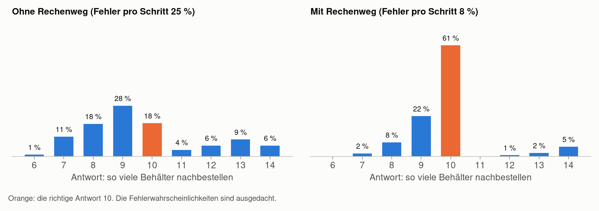
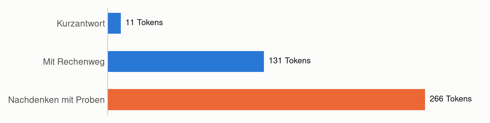

# Reasoning-Modelle: Wie ein Sprachmodell vor der Antwort nachdenkt

Frühe Chat-Assistenten schrieben flüssige Texte, scheiterten aber oft an Aufgaben mit mehreren Rechenschritten. Heutige Modelle lösen Mathe-Wettbewerbsaufgaben und schreiben lange Programme. Gebaut sind sie fast genauso wie die Sprachmodelle aus Kapitel 2. Der Unterschied: Sie schreiben vor der Antwort einen Rechenweg und wurden darauf trainiert, dabei zu richtigen Ergebnissen zu kommen.

Die Entwicklung verlief in vier Stufen: Die Modelle wurden größer, schrieben einen Rechenweg auf, wurden zu Assistenten und schließlich mit einer Belohnung für richtige Ergebnisse trainiert. Das Ergebnis heißt **Reasoning-Modell** (englisch Reasoning Model, von reasoning, schlussfolgern).

<div class="lernziele" markdown="1">

**Nach diesem Kapitel kannst du …**

- erklären, warum ein Sprachmodell bessere Ergebnisse liefert, wenn es einen Rechenweg aufschreibt.
- beschreiben, wie mehrere Antworten mit Abstimmung die Trefferquote erhöhen und wann das nicht hilft.
- in eigenen Worten sagen, wie aus einem Assistenten ein Reasoning-Modell wird.
- einschätzen, wann sich ein Reasoning-Modell lohnt und was sein Denkprotokoll aussagt.

Kästen „Für Neugierige“ enthalten Rechnungen und Hintergründe. Für den Rest des Kapitels brauchst du sie nicht.

</div>

Der Vergleich im Überblick:

| | Assistent aus Kapitel 2 | Reasoning-Modell |
| --- | --- | --- |
| Bauweise | Transformer | derselbe Transformer |
| Vor der Antwort | nichts | ein Denkprotokoll, oft hunderte bis tausende Tokens |
| Letzte Trainingsstufe | Menschen vergleichen Antworten | ein Prüfprogramm kontrolliert Ergebnisse |
| Stark bei | Formulieren, Zusammenfassen, Fragen zu Fakten | Rechnen, Programmieren, Planen, Aufgaben mit vielen Schritten |
| Tokens pro Antwort | nur die Antwort | Antwort plus Denkprotokoll, ein Vielfaches |

## 1. Eine Aufgabe mit mehreren Schritten

Der Eisverkäufer aus Kapitel 1 plant das lange Wochenende. Er hat sein Modell `Kugeln = 10 · Temperatur + 50 · Wochenende + 20` und diese Angaben (erfunden wie alle Daten im Workshop):

> Für das lange Wochenende sind angesagt: Freitag 24 °C, Samstag 27 °C, Sonntag 25 °C. In einen Behälter passen 70 Kugeln, im Gefrierschrank stehen noch 4 volle Behälter. Wie viele Behälter muss der Eisverkäufer nachbestellen?

<div class="frage" markdown="1">

**Kurz überlegen:** Kannst du die Antwort ohne Zettel nennen? Und wenn du einen Zettel nimmst: Was schreibst du zuerst auf?

<details markdown="1">
<summary>Auflösung</summary>

Kaum jemand hat die Zahl sofort im Kopf. Mit Zettel geht man Schritt für Schritt vor:

| Schritt | Rechnung | Ergebnis |
| --- | --- | --- |
| Freitag, ein Werktag | 10 · 24 + 20 | 260 Kugeln |
| Samstag, Wochenende | 10 · 27 + 50 + 20 | 340 Kugeln |
| Sonntag, Wochenende | 10 · 25 + 50 + 20 | 320 Kugeln |
| Zusammen | 260 + 340 + 320 | 920 Kugeln |
| Behälter | 920 : 70 = 13,1, also aufrunden | 14 Behälter |
| Vorrat abziehen | 14 − 4 | **10 Behälter** |

</details>
</div>

Sechs Schritte, und in jedem kann etwas schiefgehen. Wer vergisst, dass auch der Sonntag zum Wochenende gehört, kommt auf 9 Behälter. Wer 13,1 abrundet statt aufrundet, ebenfalls. Wer den Vorrat vergisst, bestellt 14. Keiner dieser Fehler fällt am Ergebnis auf: 9 und 14 sehen so plausibel aus wie 10.

Für Sprachmodelle waren solche Aufgaben lange schwer, obwohl jeder einzelne Schritt einfach ist.

> **Merke:** Viele Aufgaben bestehen aus mehreren einfachen Schritten. Schwer werden sie, weil sich ein Fehler in einem Schritt bis zum Ergebnis durchzieht.

## 2. Wie es dazu kam: von GPT-2 bis heute

Die wichtigsten Stationen:


1. **Größer werden (bis 2020).** GPT-2 konnte Texte fortsetzen, GPT-3 war über hundertmal so groß und konnte etwas Neues: Gibt man ihm im Prompt, also im Text, den es als Eingabe bekommt, ein paar Beispiele für eine Aufgabe, löst es weitere Aufgaben derselben Art, ohne dass seine Weights verändert werden. Das heißt **Lernen aus Beispielen im Prompt** (englisch In-Context Learning, mit wenigen Beispielen auch Few-Shot Learning). Bei Rechenaufgaben mit mehreren Schritten blieben die Modelle aber schwach, auch die sehr großen.
2. **Den Rechenweg aufschreiben (2022).** Forschende bei Google zeigten: Enthalten die Beispiele im Prompt einen Rechenweg, schreibt das Modell auch selbst einen und liegt viel öfter richtig (Abschnitt 4).
3. **Ein Assistent werden (2022).** Feinabstimmung und menschliches Feedback aus Kapitel 2 machten aus dem Textvervollständiger einen Assistenten. Ende 2022 erschien ChatGPT.
4. **Nachdenken lernen (seit 2024).** Modelle werden zusätzlich darauf trainiert, vor der Antwort lange nachzudenken, und dafür belohnt, wenn das Ergebnis stimmt (Abschnitt 6). OpenAI stellte im September 2024 das erste Modell dieser Art vor. Seitdem bieten die meisten großen Anbieter Reasoning-Modelle an, oft als Schalter oder Einstellung im selben Chat-Assistenten.

Bei jeder Stufe bleibt die Grundlage dieselbe: ein Transformer, der das nächste Token vorhersagt.

<details class="vertiefung" markdown="1">
<summary>Für Neugierige: Lernen aus Beispielen im Prompt</summary>

So sieht ein Prompt mit zwei Beispielen aus. Das Modell setzt das Muster fort:

```text
Sorte: Vanille → Farbe: gelb
Sorte: Pistazie → Farbe: grün
Sorte: Erdbeere → Farbe:
```

Die Weights bleiben dabei fest, wie bei jeder Anwendung. Das Modell erkennt im Text, welche Aufgabe gemeint ist, weil solche Muster in seinen Trainingsdaten häufig vorkommen. Die Studie zu GPT-3 (Brown u. a., 2020) zeigte, dass diese Fähigkeit mit der Modellgröße deutlich zunimmt.

</details>

> **Merke:** Erst wurden Sprachmodelle größer, dann zu Assistenten. Reasoning-Modelle sind Assistenten, die zusätzlich gelernt haben, vor der Antwort einen Rechenweg zu schreiben.

## 3. Warum Kopfrechnen schwerfällt

Aus Kapitel 2 ist bekannt: Ein Sprachmodell erzeugt Text Token für Token, und für jedes Token läuft das ganze Modell genau einmal durch. Für jedes Token steht also gleich viel Rechenarbeit zur Verfügung, egal ob das nächste Token ein Komma ist oder das Ergebnis einer langen Rechnung.

<div class="frage" markdown="1">

**Kurz überlegen:** Das Modell soll auf die Frage des Eisverkäufers sofort mit „Er muss 10 Behälter nachbestellen.“ antworten. Wann muss es die 10 kennen?

<details markdown="1">
<summary>Auflösung</summary>

Schon beim vierten Token. Der Tokenizer aus Kapitel 2 zerlegt die Antwort in 11 Tokens: `Er`, `␣muss`, `␣`, `10`, … Vor der 10 stehen nur drei Tokens, die mit der Rechnung nichts zu tun haben. Alle sechs Schritte müssen in den wenigen Durchläufen bis dahin passieren, ohne dass ein Zwischenergebnis irgendwo festgehalten wird.

</details>
</div>

Schreibt das Modell dagegen einen Rechenweg, steht jedes Zwischenergebnis als Text da. Für die Summe muss es nicht mehr selbst wissen, wie viel am Freitag gebraucht wird. Es schaut mit Attention (Kapitel 2, Abschnitt 5) auf die 260, die schon im Text steht:


Der Rechenweg wirkt wie ein Zettel beim Rechnen: Jedes Zwischenergebnis wird einmal ausgerechnet, aufgeschrieben und danach nur noch abgelesen. Und der Rechenweg gibt dem Modell mehr Durchläufe: 131 Tokens statt 11, also mehr als zehnmal so viel Rechenarbeit für dieselbe Frage.

<details class="vertiefung" markdown="1">
<summary>Für Neugierige: Warum ein Durchlauf begrenzt ist</summary>

Ein Transformer hat eine feste Zahl von Blöcken (Kapitel 2, Abschnitt 6). Information kann pro Durchlauf nur von Block zu Block nach oben wandern. Muss ein Ergebnis über mehr Zwischenschritte entstehen, als Blöcke da sind, wird es schwierig. Ein aufgeschriebenes Token geht dagegen beim nächsten Durchlauf wieder ganz unten als Eingabe hinein. Der Text wirkt so wie ein Speicher, mit dem das Modell beliebig viele Schritte hintereinander ausführen kann.

Schon 2021 zeigten Forschende, dass Sprachmodelle mit einem solchen „Notizblock“ (englisch Scratchpad) Rechenaufgaben und Programmabläufe deutlich besser lösen (Nye u. a., 2021).

</details>

> **Merke:** Pro Token rechnet ein Sprachmodell immer gleich viel. Ein Rechenweg gibt ihm mehr Tokens zum Rechnen und hält jedes Zwischenergebnis als Text fest.

## 4. Schritt für Schritt: Chain of Thought

Den Rechenweg bekommt man auf zwei Arten:

- **Mit Beispielen:** Man zeigt dem Modell im Prompt einige Aufgaben mitsamt Rechenweg. Es übernimmt das Muster. So machten es Forschende bei Google 2022 und gaben dem Verfahren seinen Namen: **Chain of Thought** (deutsch Gedankenkette).
- **Mit einem Satz:** Noch im selben Jahr zeigte eine Studie, dass schon der Zusatz „Denken wir Schritt für Schritt nach“ (englisch „Let's think step by step“) genügt. Bei einem Modell von OpenAI stieg der Anteil richtig gelöster Textaufgaben auf Grundschulniveau damit von 10,4 % auf 40,7 %. Weil kein Beispiel nötig ist, heißt diese Variante Zero-Shot Chain of Thought.

Wie sich das auf die Antworten auswirkt, zeigt eine kleine Simulation. Ein ausgedachtes Modell rechnet die Aufgabe des Eisverkäufers, und in jedem der sechs Schritte passiert ihm mit einer festen Wahrscheinlichkeit ein typischer Fehler, etwa die aus Abschnitt 1. Ohne Rechenweg liegt diese Wahrscheinlichkeit bei 25 % pro Schritt, mit Rechenweg bei 8 %. Beide Werte sind ausgedacht, die Rechnung dahinter ist echt:



Ohne Rechenweg trifft das Modell die 10 nur in 18 % der Fälle, mit Rechenweg in 61 %. Auffällig ist links: Die häufigste Antwort ist eine falsche. Vier verschiedene Fehler führen alle zur 9, deshalb sammeln sich dort die Stimmen. Darauf kommt Abschnitt 5 zurück.

<details class="vertiefung" markdown="1">
<summary>Für Neugierige: Wie die Simulation rechnet</summary>

Jeder Schritt geht unabhängig von den anderen schief oder nicht. Bei sechs Schritten gibt es 2⁶ = 64 Möglichkeiten, welche Schritte danebengehen. Das Skript rechnet jede davon durch und gewichtet sie mit ihrer Wahrscheinlichkeit. Richtig ist die Antwort, wenn kein Schritt schiefgeht:

- ohne Rechenweg: 0,75⁶ ≈ 0,18
- mit Rechenweg: 0,92⁶ ≈ 0,61

Dazu kommen wenige Fälle, in denen sich mehrere Fehler zufällig aufheben. Ohne Rechenweg sind das 0,3 % der Antworten, deshalb steht im Diagramm 18 % statt 17,8 %.

Bei vielen Schritten wirken schon kleine Fehlerquoten stark. Mit 20 Schritten und 8 % Fehler pro Schritt wären nur noch 19 % der Antworten richtig. Dieselbe Rechnung gilt für Agenten, die viele Werkzeuge nacheinander aufrufen ([Kapitel 4, Abschnitt 9](04-Vom-Chat-zum-Agenten.md#9-risiken-fehlerketten-und-eingeschleuste-anweisungen)).

</details>

> **Merke:** Mit einem Rechenweg macht ein Sprachmodell pro Schritt weniger Fehler. Weil jeder Schritt stimmen muss, steigt der Anteil richtiger Antworten deutlich.

## 5. Mehrmals rechnen, dann abstimmen

Aus Kapitel 2 ist bekannt: Das nächste Token wird ausgelost. Stellt man dieselbe Frage mehrmals, kommen verschiedene Rechenwege und manchmal verschiedene Ergebnisse heraus.

<div class="frage" markdown="1">

**Kurz überlegen:** Du lässt fünf Personen unabhängig voneinander die Aufgabe des Eisverkäufers rechnen. Drei kommen auf 10, eine auf 9, eine auf 14. Welcher Zahl traust du?

<details markdown="1">
<summary>Auflösung</summary>

Der 10. Richtige Rechenwege führen alle zum selben Ergebnis. Fehler führen in verschiedene Richtungen und verteilen sich deshalb auf mehrere falsche Zahlen.

</details>
</div>

Dasselbe funktioniert mit einem Sprachmodell: mehrere Antworten mit Rechenweg erzeugen und das Ergebnis nehmen, das am häufigsten vorkommt. Das Verfahren heißt **Selbstkonsistenz** (englisch Self-Consistency) oder Mehrheitsentscheid (englisch Majority Voting). In der Simulation sieht das so aus:


Mit Rechenweg steigt die Trefferquote von 61 % bei einer Antwort auf 91 % bei neun Antworten. Ohne Rechenweg hilft die Abstimmung nicht: Dort ist die 9 häufiger als die 10, und eine Abstimmung bestätigt die häufigste Antwort, auch wenn sie falsch ist.

Echte Modelle verhalten sich ähnlich. In der Studie, die das Verfahren 2022 vorstellte, stieg der Anteil gelöster Textaufgaben bei einem Modell von Google von 56,5 % mit einem Rechenweg auf 74,4 % mit einer Abstimmung über 40 Rechenwege.

<details class="vertiefung" markdown="1">
<summary>Für Neugierige: Wann eine Abstimmung hilft</summary>

Eine Abstimmung hilft, wenn die richtige Antwort häufiger vorkommt als jede einzelne falsche. Sie muss dafür nicht über 50 % liegen. Mit Rechenweg ist die 10 mit 61 % häufiger als die 9 mit 22 %, also gewinnt sie mit jeder weiteren Stimme öfter. Ohne Rechenweg liegt die 9 mit 28 % vor der 10 mit 18 %, und mit vielen Stimmen gewinnt fast immer die 9.

Abgestimmt wird nur über das Endergebnis, nicht über den Rechenweg. Das geht deshalb gut bei Zahlen, Ja-Nein-Fragen oder Auswahlantworten, schlecht bei frei formulierten Texten.

</details>

> **Merke:** Mehrere Rechenwege und ein Mehrheitsentscheid erhöhen die Trefferquote. Das klappt nur, wenn die richtige Antwort die häufigste ist.

## 6. Belohnung für richtige Ergebnisse

Bis hierher kam der Rechenweg aus dem Prompt: Man musste das Modell darum bitten. Reasoning-Modelle haben gelernt, von sich aus nachzudenken. Dafür gibt es eine weitere Trainingsstufe.

<div class="frage" markdown="1">

**Kurz überlegen:** Du willst jemandem Bruchrechnen beibringen, kannst aber nur das Endergebnis kontrollieren, nicht den Rechenweg. Wie gehst du vor?

<details markdown="1">
<summary>Auflösung</summary>

Viele Aufgaben stellen und nur sagen: richtig oder falsch. Wer übt, merkt mit der Zeit selbst, welche Vorgehensweisen zu richtigen Ergebnissen führen, etwa sauber Zwischenergebnisse notieren oder am Ende die Probe machen. Ein Reasoning-Modell lernt auf diese Weise.

</details>
</div>

Diese Stufe heißt **Verstärkungslernen** (englisch Reinforcement Learning). Das Modell bekommt Aufgaben mit einer prüfbaren Lösung, vor allem aus Mathematik und Programmierung. Es darf beliebig lange nachdenken und gibt dann eine Antwort. Ein **Prüfprogramm** (englisch Verifier) kontrolliert nur das Ergebnis: Stimmt die Zahl? Laufen die Tests des Programms durch? Antworten, die richtig waren, werden wahrscheinlicher gemacht, falsche unwahrscheinlicher. Weil die Belohnung (englisch Reward) aus einer nachprüfbaren Lösung kommt, heißt das Verfahren auch Reinforcement Learning with Verifiable Rewards, kurz RLVR. Das ist dasselbe Prinzip wie beim menschlichen Feedback, nur bewertet hier ein Programm statt eines Menschen:


Ein Prüfprogramm wird nicht müde und kann Millionen Antworten bewerten. Deshalb lässt sich diese Stufe sehr lange fortsetzen.

Was dabei passiert, zeigt eine Spielzeug-Simulation mit der Aufgabe des Eisverkäufers. Das ausgedachte Modell hat nur eine Stellschraube: wie oft es einen Rechenschritt nachprüft. Eine Prüfung kostet etwa 21 Tokens und findet einen Fehler in diesem Schritt mit einer Wahrscheinlichkeit von 80 %. Zu Beginn prüft das Modell nur 8 % der Schritte. Niemand sagt ihm, dass Prüfen hilft, es bekommt nur „richtig“ oder „falsch“ für das Endergebnis:


Nach 150 Runden prüft das Modell 95 % der Schritte. Der Anteil richtiger Antworten steigt von 63 % auf 89 %, die Antworten werden fast doppelt so lang.

Bei echten Modellen ist das Ergebnis ähnlich. Das Team von DeepSeek trainierte ein Sprachmodell nur mit solchen Belohnungen, ohne Beispielgespräche vorweg. Bei den Aufgaben eines US-amerikanischen Mathematik-Wettbewerbs für Schülerinnen und Schüler (AIME 2024) stieg der Anteil gelöster Aufgaben im Lauf des Trainings von 15,6 % auf 71,0 %, mit Abstimmung über mehrere Antworten auf 86,7 %. Die Antworten wurden von selbst immer länger. Das Modell begann, Zwischenergebnisse zu überprüfen und Lösungswege zu verwerfen. In seinen Denkprotokollen tauchten Sätze auf wie „Moment, das schaue ich mir noch einmal Schritt für Schritt an“. Das Forschungsteam nannte das einen Aha-Moment (englisch Aha Moment).

<details class="vertiefung" markdown="1">
<summary>Für Neugierige: Wie die Belohnung zu den Weights kommt</summary>

Im Spielzeugmodell gibt es eine einzige Stellschraube, die Prüfquote. In jeder Runde erzeugt es 32 Antworten. Wurde in einer überdurchschnittlich belohnten Antwort öfter geprüft als erwartet, steigt die Prüfquote ein Stück. Wurde in einer schlechter belohnten Antwort öfter geprüft, sinkt sie. Das Verfahren heißt REINFORCE und ist eine Form des Gradientenabstiegs aus Kapitel 1. Der Unterschied: Die Richtung ergibt sich nicht aus einem Fehler, der sich direkt ableiten lässt, sondern aus dem Vergleich besser und schlechter belohnter Versuche.

Ein echtes Modell hat statt einer Stellschraube Milliarden Weights. Das Prinzip bleibt: Tokens in Antworten, die überdurchschnittlich belohnt wurden, werden wahrscheinlicher. DeepSeek verwendete eine Variante namens GRPO, die für jede Aufgabe eine Gruppe von Antworten erzeugt und jede Antwort mit dem Durchschnitt ihrer Gruppe vergleicht.

Die Belohnung funktioniert dort am besten, wo sich Ergebnisse automatisch prüfen lassen: Mathematik, Programmierung, Logikrätsel. Für Aufsätze oder Ratschläge gibt es kein Prüfprogramm. Dort wird weiter mit menschlichem Feedback oder mit Modellen gearbeitet, die menschliche Bewertungen nachahmen (englisch Reward Models).

Ein fertiges Reasoning-Modell kann auch kleinere Modelle unterrichten: Man trainiert sie mit seinen Denkprotokollen wie mit Beispielgesprächen bei der Feinabstimmung. Das heißt **Destillation** (englisch Distillation). DeepSeek veröffentlichte auf diese Weise mehrere kleine Modelle, die auf einem gewöhnlichen Rechner laufen.

</details>

> **Merke:** Reasoning-Modelle werden belohnt, wenn ihr Ergebnis stimmt. Wie sie dahin kommen, lernen sie selbst. Dabei werden ihre Denkprotokolle länger und gründlicher.

## 7. Nachdenken kostet Zeit und Tokens

Ein Reasoning-Modell schreibt vor der Antwort ein **Denkprotokoll** (auch Gedankengang, englisch Reasoning Trace). Für die Aufgabe des Eisverkäufers könnte es so aussehen. Der Text ist ausgedacht, aber typisch für solche Protokolle:

```text
Gefragt sind Behälter, nicht Kugeln. Ich rechne erst den Bedarf für jeden Tag aus.
Freitag, 24 °C, Werktag: 10 · 24 + 20 = 260 Kugeln.
Samstag, 27 °C, Wochenende: 10 · 27 + 50 + 20 = 340 Kugeln.
Sonntag, 25 °C: 10 · 25 + 20 = 270 Kugeln.
Moment, der Sonntag gehört auch zum Wochenende. Also 10 · 25 + 50 + 20 = 320 Kugeln.
Zusammen: 260 + 340 + 320 = 920 Kugeln. Probe: 260 + 340 = 600, dazu 320 ergibt 920.
920 : 70 = 13,14. 13 Behälter reichen nur für 910 Kugeln, das sind 10 zu wenig. Also 14 Behälter.
Im Gefrierschrank stehen 4: 14 − 4 = 10.
Gegenprobe: 10 neue und 4 alte Behälter fassen 14 · 70 = 980 Kugeln, das reicht für 920.
Antwort: 10 Behälter.
```

Danach folgt die eigentliche Antwort: „Er muss 10 Behälter nachbestellen.“ Das Modell plant, macht einen Fehler, bemerkt ihn und rechnet zweimal nach. Das kostet Tokens:



Denkprotokoll und Antwort zusammen haben 266 Tokens statt 11, also 24-mal so viele. Bei schwierigen Aufgaben denken echte Modelle oft mehrere tausend Tokens lang nach. Weil jedes Token einen Durchlauf des Modells braucht, steigen damit die Wartezeit und der Preis. Auch das Denkprotokoll wird in Tokens abgerechnet, auch wenn man es nicht sieht.

Dafür werden die Antworten besser. OpenAI veröffentlichte zu seinem ersten Reasoning-Modell o1 Ergebnisse beim Mathematik-Wettbewerb AIME 2024: Der Assistent GPT-4o löste im Schnitt 12 % der Aufgaben, o1 mit einer einzigen Antwort 74 % und mit Abstimmung über 64 Antworten 83 %. Je länger o1 nachdenken durfte, desto mehr Aufgaben löste es.

Damit gibt es neben den Stellschrauben aus Kapitel 2 (Parameter, Daten, Rechenaufwand beim Training) eine weitere. Ein Modell wird nicht nur besser, wenn man **beim Training** mehr rechnet, sondern auch, wenn man **bei der Antwort** mehr rechnen lässt. Das heißt im Englischen Test-Time Compute, Rechenaufwand zur Antwortzeit. Viele Assistenten lassen deshalb wählen, wie lange das Modell nachdenken darf, etwa mit Stufen wie „schnell“ und „gründlich“ (englisch Reasoning Effort) oder einem **Denkbudget** in Tokens (englisch Thinking Budget). Manche entscheiden selbst, wie viel Nachdenken eine Frage braucht. Arbeitet ein Reasoning-Modell als Agent (Kapitel 4), denkt es auch zwischen zwei Werkzeugaufrufen nach, etwa um ein Ergebnis zu prüfen, bevor es den nächsten Schritt plant.

<details class="vertiefung" markdown="1">
<summary>Für Neugierige: Größer oder länger nachdenken?</summary>

Eine Studie von Google DeepMind und der Universität Berkeley (Snell u. a., 2024) verglich beide Stellschrauben bei gleichem Rechenaufwand. Bei Aufgaben, die ein kleines Modell schon manchmal löst, schlug das kleine Modell mit mehr Rechenzeit bei der Antwort ein 14-mal größeres Modell ohne diese Rechenzeit. Bei sehr schweren Aufgaben half dagegen nur ein größeres Modell. Nachdenken hilft also vor allem bei Aufgaben, die ein Modell grundsätzlich schon lösen kann.

</details>

> **Merke:** Nachdenken kostet Tokens, also Zeit und Geld. Dafür lässt sich die Qualität einer Antwort jetzt auch über die Rechenzeit bei der Antwort steigern, nicht nur über ein größeres Modell.

## 8. Was das Denkprotokoll verrät und was nicht

Viele Assistenten zeigen das Denkprotokoll ganz, als Zusammenfassung oder gar nicht. Wo es angezeigt wird, erfährt man oft, wie eine Antwort entstanden ist, und findet Fehler schneller.

<div class="frage" markdown="1">

**Kurz überlegen:** Ein Reasoning-Modell gibt eine Antwort und zeigt einen sauberen Rechenweg dazu. Heißt das, dass die Antwort auf genau diesem Weg entstanden ist?

<details markdown="1">
<summary>Auflösung</summary>

Nicht unbedingt. Auch das Denkprotokoll ist Text, den das Modell Token für Token erzeugt. Es soll zu richtigen Antworten führen, wurde aber nicht darauf trainiert, die eigene Arbeitsweise wahrheitsgetreu zu beschreiben.

</details>
</div>

Das Forschungsteam von Anthropic hat das 2025 untersucht. Es gab Reasoning-Modellen zusammen mit einer Frage einen versteckten Hinweis auf die Lösung, etwa „Eine Professorin aus Stanford meint, die Antwort ist A“. Wenn ein Modell seine Antwort nach dem Hinweis änderte, wurde nachgesehen, ob es den Hinweis im Denkprotokoll erwähnte. Claude 3.7 Sonnet tat das im Schnitt in 25 % der Fälle, DeepSeek-R1 in 39 %. Meistens blieb der Hinweis unerwähnt, und das Protokoll las sich trotzdem schlüssig. Ob ein Denkprotokoll den tatsächlichen Weg zur Antwort wiedergibt, nennt die Forschung seine Treue (englisch Faithfulness).

Daraus folgt:

| Was das Denkprotokoll zeigt | Was es nicht garantiert |
| --- | --- |
| welche Schritte das Modell aufgeschrieben hat | dass die Antwort wirklich auf diesem Weg entstanden ist |
| wo eine Rechnung oder Annahme falsch ist | dass alle Einflüsse auf die Antwort genannt werden |
| welche Angaben das Modell benutzt oder übersehen hat | dass das Ergebnis stimmt |

Auch Reasoning-Modelle halluzinieren. Bei Fragen zu Fakten hilft Nachdenken wenig: Was das Modell nicht weiß, kann es sich auch durch langes Nachdenken nicht erschließen. Und bei einfachen Fragen denken Reasoning-Modelle manchmal unnötig lange nach und machen eine schlichte Antwort kompliziert (englisch Overthinking).

> **Merke:** Das Denkprotokoll hilft beim Nachvollziehen und beim Finden von Fehlern. Es ist aber kein Beweis dafür, wie die Antwort zustande kam.

## 9. Was das für den Alltag heißt

Für die Arbeit mit Chat-Assistenten folgt daraus:

- **Das passende Modell wählen.** Für Aufgaben mit vielen Schritten lohnt sich ein Reasoning-Modell oder eine gründliche Einstellung: Rechnungen, Tabellen auswerten, Programmcode, Pläne mit Abhängigkeiten, Texte auf Widersprüche prüfen. Für Formulieren, Übersetzen, Zusammenfassen und kurze Fragen genügt meist das schnelle Modell.
- **Die ganze Aufgabe nennen.** Ein Reasoning-Modell muss man nicht mehr zum „Schritt für Schritt“ auffordern, es tut das von selbst. Wichtiger ist, das Ziel, alle Angaben und die Bedingungen zu nennen, an denen sich ein gutes Ergebnis messen lässt. „Es müssen ganze Behälter sein, und der Vorrat zählt mit“ hilft mehr als jede Aufforderung zum Nachdenken.
- **Bei einfachen Modellen den Rechenweg verlangen.** Wer kein Reasoning-Modell zur Verfügung hat, kann um einen Rechenweg bitten. Das hilft auch beim Prüfen.
- **Ergebnisse trotzdem prüfen.** Eine überzeugende Begründung ist kein Beweis. Zahlen, die weiterverwendet werden, nachrechnen oder mit einem Werkzeug kontrollieren (Kapitel 4).
- **Bei wichtigen Fragen mehrmals fragen.** Kommen bei mehreren Versuchen verschiedene Ergebnisse heraus, ist das ein Warnzeichen (Abschnitt 5).
- **Wartezeit und Kosten einplanen.** Gründliches Nachdenken kann Minuten dauern und verbraucht ein Vielfaches an Tokens. Bei Diensten, die nach Tokens abrechnen, zählt das Denkprotokoll mit.

> **Merke:** Reasoning-Modelle lohnen sich für Aufgaben mit vielen Schritten. Sie brauchen eine vollständige Aufgabenstellung, keine Aufforderung zum Nachdenken. Ihre Ergebnisse müssen trotzdem geprüft werden.

## Das Wichtigste in Kürze

- Ein Sprachmodell rechnet **pro Token gleich viel**. Für Aufgaben mit vielen Schritten reicht das ohne Rechenweg oft nicht.
- **Chain of Thought:** Ein aufgeschriebener Rechenweg gibt dem Modell mehr Tokens zum Rechnen und hält jedes Zwischenergebnis fest. Der Anteil richtiger Antworten steigt deutlich.
- **Selbstkonsistenz:** Mehrere Rechenwege erzeugen und über das Ergebnis abstimmen. Das hilft, wenn die richtige Antwort die häufigste ist.
- **Reasoning-Modelle** bekommen eine weitere Trainingsstufe: **Verstärkungslernen** mit einer Belohnung, wenn das Ergebnis stimmt. Gründliches Nachdenken mit Proben entsteht dabei von selbst.
- **Nachdenken kostet** Tokens, Zeit und Geld. Dafür lässt sich die Qualität einer Antwort jetzt auch über die Rechenzeit bei der Antwort steigern.
- Das **Denkprotokoll** hilft beim Nachvollziehen, beschreibt aber nicht zuverlässig, wie die Antwort entstanden ist.
- Für Aufgaben mit vielen Schritten ein Reasoning-Modell wählen, die Aufgabe vollständig beschreiben und Ergebnisse prüfen.

## Teste dich

<details class="quiz" markdown="1">
<summary>Warum liegt ein Sprachmodell bei Rechenaufgaben öfter richtig, wenn es einen Rechenweg aufschreibt?</summary>

Weil es pro Token immer gleich viel rechnet. Mit Rechenweg hat es mehr Tokens, also mehr Durchläufe, und jedes Zwischenergebnis steht als Text da. Für den nächsten Schritt muss es das Zwischenergebnis nur noch ablesen.

</details>

<details class="quiz" markdown="1">
<summary>Fünf Antworten auf dieselbe Frage lauten 9, 9, 10, 9, 14. Ist die 9 damit sicher richtig?</summary>

Nein. Eine Abstimmung findet die häufigste Antwort. Wenn mehrere typische Fehler zum selben falschen Ergebnis führen, gewinnt die falsche Antwort. In der Simulation ohne Rechenweg passiert genau das.

</details>

<details class="quiz" markdown="1">
<summary>Was ist bei Reasoning-Modellen anders als beim menschlichen Feedback aus Kapitel 2?</summary>

Bewertet wird nicht von Menschen, sondern von einem Prüfprogramm, und zwar nur das Endergebnis. Das Modell darf vorher beliebig lange nachdenken. Wie es zum Ergebnis kommt, lernt es selbst.

</details>

<details class="quiz" markdown="1">
<summary>Warum sind Antworten von Reasoning-Modellen teurer, auch wenn die sichtbare Antwort kurz ist?</summary>

Weil das Denkprotokoll ebenfalls aus Tokens besteht, die das Modell eins nach dem anderen erzeugt. Das Modell muss sie alle erzeugen, und sie werden meist mit abgerechnet, auch wenn sie nicht angezeigt werden.

</details>

<details class="quiz" markdown="1">
<summary>Ein Reasoning-Modell zeigt einen fehlerfreien Rechenweg. Kannst du das Ergebnis ungeprüft übernehmen?</summary>

Nein. Das Denkprotokoll ist selbst erzeugter Text und beschreibt nicht zuverlässig, wie die Antwort entstanden ist. Außerdem können Angaben fehlen oder Fakten falsch sein. Wichtige Zahlen nachrechnen.

</details>

## Selbst ausprobieren

In [Labor 5](app/labor-5.html) kannst du das ausgedachte Modell aus diesem Kapitel selbst rechnen lassen, mit und ohne Rechenweg. Du kannst einstellen, wie oft es sich verrechnet, über beliebig viele Antworten abstimmen und das Spielzeug-Training aus Abschnitt 6 Runde für Runde beobachten. Außerdem zeigt das Labor die drei Antworten aus Abschnitt 7 als Tokens. Es läuft direkt im Browser, auch ohne Internetverbindung.

<details class="vertiefung" markdown="1">
<summary>Für technisch Interessierte: Alles selbst nachrechnen</summary>

Ein Python-Skript rechnet alle Zahlen dieses Kapitels nach, spielt die Simulationen durch und erzeugt die Grafiken und die Daten für das Labor neu. Dafür wird [uv](https://docs.astral.sh/uv/) benötigt. Beim ersten Start lädt tiktoken das Vokabular aus dem Internet, wie in Kapitel 2.

```bash
uv run docs/beispiele/05_nachdenken.py
```

Die ausgedachten Fehlerwahrscheinlichkeiten stehen am Anfang von [`beispiele/05_nachdenken.py`](beispiele/05_nachdenken.py) und lassen sich dort ändern.

</details>

## Quellen

- Brown u. a. (2020): [Language Models are Few-Shot Learners](https://arxiv.org/abs/2005.14165) (GPT-3)
- Nye u. a. (2021): [Show Your Work: Scratchpads for Intermediate Computation with Language Models](https://arxiv.org/abs/2112.00114)
- Wei u. a. (2022): [Chain-of-Thought Prompting Elicits Reasoning in Large Language Models](https://arxiv.org/abs/2201.11903)
- Kojima u. a. (2022): [Large Language Models are Zero-Shot Reasoners](https://arxiv.org/abs/2205.11916)
- Wang u. a. (2022): [Self-Consistency Improves Chain of Thought Reasoning in Language Models](https://arxiv.org/abs/2203.11171)
- Snell u. a. (2024): [Scaling LLM Test-Time Compute Optimally can be More Effective than Scaling Model Parameters](https://arxiv.org/abs/2408.03314)
- OpenAI (2024): [Learning to reason with LLMs](https://openai.com/index/learning-to-reason-with-llms/)
- DeepSeek-AI (2025): [DeepSeek-R1: Incentivizing Reasoning Capability in LLMs via Reinforcement Learning](https://arxiv.org/abs/2501.12948)
- Anthropic (2025): [Claude 3.7 Sonnet and Claude Code](https://www.anthropic.com/news/claude-3-7-sonnet)
- Chen u. a. (2025): [Reasoning Models Don't Always Say What They Think](https://arxiv.org/abs/2505.05410)
